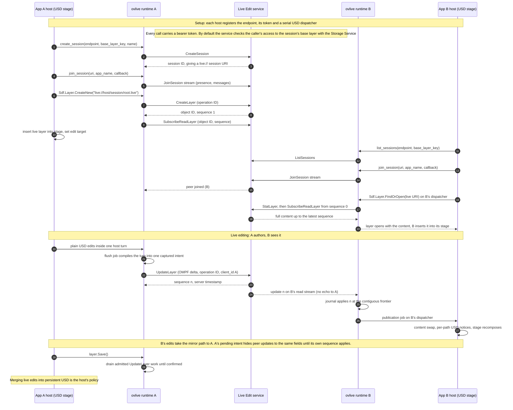
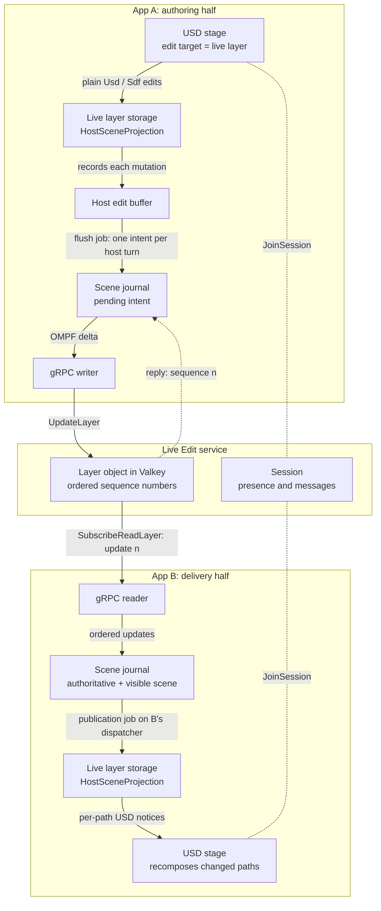

<!-- SPDX-FileCopyrightText: Copyright (c) 2026 NVIDIA CORPORATION & AFFILIATES. All rights reserved. -->
<!-- SPDX-License-Identifier: Apache-2.0 -->

# ovlive — live OpenUSD collaboration for standalone applications and Kit

**ovlive** is the live collaboration product of **Omniverse Content Services**: a client that applications embed and the Live Edit service they connect to. Several processes join the same live session associated with a USD layer, open its live layer, edit it with ordinary `Usd` and `Sdf` calls, and see each other's edits in near real time. The client is one C++ runtime in the shared library `omni_usd_live`, with a C ABI, a C++ USD host adapter, the `omni.usd.live` Python package and a Kit extension. The service is a gRPC server that applies each layer delta, streams it to the other participants and tracks session presence, with its live state in Valkey.

> **[Start with the client](client/README.md#quick-start)** or **[run the service](service/README.md#run-locally)** · Add shared, near-real-time OpenUSD editing to a USD host application, a Python tool or a Kit application. The host supplies the endpoint, the credentials and a serial USD dispatcher; the client owns transport, reconciliation, status and recovery for every live layer, and the service keeps the shared, ordered state.
>
> *Experimental prerelease: the client is version 0.1.0, and the service is published from its own releases. Zero-major releases do not promise a stable API or ABI, and the service's `v1alpha` RPC interface is experimental. The [client support boundary](client/docs/ovlive-support-boundary.md) states what is supported and tested, the open qualification gates and the known limitations; the [service API documentation](service/docs/api/docs/index.md) states the RPC contract.*

---

## 1. What is ovlive?

**ovlive is the live-editing product monorepo in Omniverse Content Services.** It holds both halves of live collaboration, so integrators, operators and maintainers find them from one entry point:

| Part | What it does | Start here |
|---|---|---|
| **[Client](client/README.md)** | A C++ runtime that serves the USD `.live` file format and `live://` resolver over a Live Services gRPC endpoint, with its USD integration, C, C++, Python and Kit bindings, samples and tests. The standalone runtime works without a Kit installation. | [Client quick start](client/README.md#quick-start) |
| **[Service](service/README.md)** | The Live Edit service: a gRPC server for `nvidia.omniverse.live.v1alpha.LiveService` that applies each delta to its copy of the layer, streams it to the other participants, tracks presence and relays session messages. Its replicas share live state in Valkey and need no session affinity, and it checks each caller's access to the session's base layer with a Storage Service. | [Run locally](service/README.md#run-locally) · [Deploy with Helm](service/docs/service/docs/deployment.md) |

Deploying the service does not make an arbitrary USD application collaborative: each participating application integrates the client, or another client of the LiveService protocol.

An application opens a live layer on its publication context, inserts it into a stage, makes it the edit target and authors through plain USD. The runtime sends local edits to the service, applies peer edits, and reports typed status, authentication challenges and diagnostics. The host owns login, session UI and the policy for merging collaborative edits into persistent content. Live layers are attached in memory: no sublayer, reference or payload in loaded or saved content names a `live://` URI ([design](client/docs/ovlive-design.md#1-purpose-audience-and-scope)).

A live layer has no file on disk. Its identifier is a `live://` URI whose layer name ends in `.live`, such as `live://live.example.internal/<escaped-session-id>/root.live`, and the Live Edit service holds its content. ovlive's `.live` format is separate from Omniverse Nucleus live layers served by `omni.client` and `omni.usd_resolver`; it neither reads nor writes them, and one process cannot register both `.live` handlers. The [reference](client/docs/ovlive-reference.md#live-layers-and-the-live-format) gives the registration, read and export rules.

### How two applications share a live layer

Two host applications, A and B, each load `omni_usd_live` and register the same Live Edit service endpoint with their own credentials. A creates a session for a base layer and a live layer in it; B finds the session and opens the same live layer. Each then authors with plain USD, and its runtime carries the edits through the service to the other.

The data flow below follows one edit from A to B. Every runtime runs both halves: the authoring half captures host edits at the layer's storage and sends them as ordered updates, and the delivery half turns the service's ordered stream back into USD content. B's edits take the mirror path to A. Runtime threads never call USD; only jobs that the host's dispatcher runs touch a live layer ([design section 7](client/docs/ovlive-design.md#7-host-concurrency-and-scheduling-contract)).

Each runtime uses one writer ID per endpoint, so the service never echoes a writer's own updates back on its read stream; A's pending intent retires only once A's contiguous sequence frontier reaches the intent's sequence number, never on the reply alone. The [design](client/docs/ovlive-design.md) covers the reconciliation rules ([section 8](client/docs/ovlive-design.md#8-authoring-and-reconciliation-model)), stream ordering and reconnect ([section 12](client/docs/ovlive-design.md#12-stream-ordering-coverage-and-reconnect)) and recovery ([section 13](client/docs/ovlive-design.md#13-mutation-outcomes-retry-policy-and-recovery)).

### Where it fits in Omniverse Content Services

ovlive works beside the other Omniverse Content Services repositories; each has its own installation, compatibility and licensing requirements.

| Repository | Role in the stack | How it fits with ovlive |
|---|---|---|
| **ovlive** (this repository) | Synchronize OpenUSD edits between participants through `.live` layers and the Live Edit service. | Supplies the client runtime, its USD integration and bindings, and the Live Edit service. |
| **[ovstorage](https://github.com/NVIDIA-Omniverse/ovstorage)** | Access content through portable libraries, plugins, CLI and MCP. | Gives a host the base scenes and asset files it composes under live layers; live-layer traffic uses ovlive's own protocol and resolver. |
| **[usd-content-workspace](https://github.com/NVIDIA-Omniverse/usd-content-workspace)** | Service APIs and adapters for storage, metadata, permissions, identity, notifications, discovery and thumbnails. | Provides the Storage Service that holds each session's base layer and authorizes access to it, the optional user identity service, and the content services around the scenes that participants edit together. |

### Repository layout

| Path | What you will find |
|---|---|
| [client/](client/README.md) | The ovlive client: native interfaces, runtime, USD integration, Python package, Kit extension, protocol, samples, tests and build tools. Its README holds the quick start and maps each component. |
| [service/](service/README.md) | The Live Edit service: source, protobuf definitions, Helm chart, container build, conformance suite and service documentation. |
| Repository root | License and notices, contribution policy and security reporting. Builds and evidence go under `.cache`. |

---

## 2. What functionalities are available, and who are the target users?

**What you can do with it:**

- **Share USD edits across processes** — open `.live` layers, set the USD edit target and author with ordinary USD APIs while the runtime applies peer changes.
- **Coordinate live sessions** — create, list, join and leave sessions; observe participant presence and exchange application messages.
- **Embed collaboration in your host** — use the C ABI, the C++ USD adapter, the Python package or the Kit extension over one runtime.
- **Handle failures explicitly** — consume typed status, authentication challenges and diagnostics; a rejected or unresolved write fails the layer and keeps its edits for export and reopen, as the [reference](client/docs/ovlive-reference.md) describes.
- **Run and scale the service** — run the Live Edit service locally or as a container, deploy it on Kubernetes with its Helm chart, choose a durability mode for its Valkey state, and add replicas behind a load balancer.
- **Learn and validate integrations** — run the native and Python participant samples and the diagnostics sample, exercise the client's deterministic reference-service test suites, and check a running service through its public gRPC API with the conformance suite.

**Who benefits:**

- **USD application and digital-twin developers** — add collaborative authoring to scene assembly and editing tools.
- **Automation and agent developers** — coordinate several processes editing shared USD layers through the Python or native interfaces.
- **C++ and Python host integrators** — embed live editing in standalone applications with explicit control over threading, credentials and session policy.
- **Kit application teams** — load the Kit extension in a Kit application.
- **Platform operators and service engineers** — deploy, configure, monitor and upgrade the Live Edit service, and validate a deployment or another implementation of the LiveService contract.

---

## 3. Documentation and reference links

### Quick start

- **Client:** the [client quick start](client/README.md#quick-start) builds and stages a package, checks that it loads, runs the native participant and diagnostics samples against the client's in-repository reference service, and points to connecting your own endpoint.
- **Service:** [run the service locally](service/README.md#run-locally) against a throwaway Valkey, or follow the [deployment guide](service/docs/service/docs/deployment.md) for the Helm chart. Point the client at that endpoint with a token the service accepts.

The client's `plugin-reference` and `python-reference` suites try the native and Python clients without a deployed service. Their reference service is a test fixture that the suites start on loopback; it is not the Live Edit service and has no standalone server command. The [service conformance suite](service/conformance_tests/README.md) tests a running Live Edit service through its public gRPC API, with core tests and optional `deployment`, `permissions` and `multi_replica` profiles.

### Guides and project process

- **Client guides:** the [client documentation index](client/docs/README.md), including the API reference, design, samples and diagnostics.
- **Service guides:** the [service README](service/README.md) for architecture, build, local runs and the container image; the [operator documentation](service/docs/service/docs/index.md) for deployment, backing stores, configuration, monitoring and upgrades; and the [client API documentation](service/docs/api/docs/index.md) for the RPCs, error codes, retries and limits, defined in [live_service.proto](service/proto/nvidia/omniverse/live/v1alpha/live_service.proto).
- **API references:** the C ABI in [Live.h](client/include/omni/usd/live/Live.h), the C++ host adapter in [LiveUsd.h](client/include/omni/usd/live/LiveUsd.h), their semantics, result codes, options, defaults and limits in the [reference](client/docs/ovlive-reference.md), and every public `omni.usd.live` name in the [Python API reference](client/docs/ovlive-python.md#api-reference).
- **Build and test:** [build](client/docs/ovlive-build.md) and [testing](client/docs/ovlive-testing.md).
- **Assess readiness:** the client [support boundary](client/docs/ovlive-support-boundary.md), and the [client](client/CHANGELOG.md) and [service](service/CHANGELOG.md) changelogs.
- **Project policy:** [contributing](CONTRIBUTING.md), [security reporting](SECURITY.md) and [code of conduct](CODE_OF_CONDUCT.md).

---

## 4. System requirements

### Client

The [support boundary](client/docs/ovlive-support-boundary.md) defines these targets. A package's USD and Python SDKs must match the consuming host:

| USD profile | Platforms | Python | Status |
|---|---|---|---|
| `kit-25.11` — Kit USD 25.11 ABI | Linux x86-64, Linux aarch64, Windows x86-64 | CPython 3.12 | Release target |
| `stock-25.11` — stock OpenUSD 25.11 | Linux x86-64 | CPython 3.12 | Release target |

- **macOS:** The ovlive client has been built and run on macOS arm64 as an experiment, against stock OpenUSD 25.11 and Python 3.12 built from pinned sources ([macOS source build](client/docs/ovlive-build.md#macos-source-sdks)), but this platform is unsupported. macOS has no release, packman package, Kit support or release qualification, and the reference-service test suites do not run there; successful local use does not establish compatibility.

- **Build inputs:** CMake 3.20+, C and C++17 compilers, Make or Ninja, matching USD and Python SDKs, pybind11 and the pinned gRPC/protobuf dependencies. See the [prerequisites](client/docs/ovlive-build.md#prerequisites) and [SDK identities](client/deps/README.md#host-sdk-identities).
- **Runtime integration:** a Live Edit service endpoint, or another compatible LiveService endpoint, credentials that service accepts and a host-owned serial USD dispatcher. The package uses the host's matching USD and Python shared libraries.
- **Kit integration:** an internal Kit build with the companion extensions. The extension does not start on stock public Kit 110.3; see [what works with a public Kit build](client/docs/ovlive-kit.md#what-works-with-a-public-kit-build).

The client's automated service tests run against its independent reference service. Validation of the client against deployed services happens outside this repository, and the open performance, Kit, platform and other release gates are listed in the [support boundary](client/docs/ovlive-support-boundary.md).

### Service

- **Build inputs:** the toolchain that `service/rust-toolchain.toml` pins, installed with `rustup`, `protoc` 3.x or later, `flatc` 24.3.25 with its C++ headers, a C++17 compiler, and on Linux `make` and a C compiler. See the [service prerequisites](service/README.md#prerequisites).
- **Backing store:** a Valkey with `maxmemory-policy noeviction` and a durability layer: append-only-file persistence, checkpointing to a backup store, or both. The service refuses to start without one; [choose and size a backing store](service/docs/service/docs/index.md) with the operator documentation.
- **Authorization and identity:** a Storage Service that holds each session's base layer and checks callers' access to it, which is on by default, and an optional userinfo service; otherwise each bearer token must be a JWT. The [configuration reference](service/docs/service/docs/configuration.md) lists every setting.
- **Deployment:** Kubernetes and Helm for the [`live-edit-service` chart](service/docs/service/docs/deployment.md). Replicas serve plaintext HTTP/2 on port 50001, so client TLS ends at the ingress or load balancer and direct access to the replica ports should be restricted, and Prometheus metrics on port 9090.

---

## 5. Licensing

- **Source:** NVIDIA-owned source and documentation are licensed under the [Apache License, Version 2.0](LICENSE).
- **Third-party components:** preserve [NOTICE](NOTICE), [third-party notice index](THIRD_PARTY_NOTICES.md) and the bundled dependency licenses when redistributing. Client native packages contain statically linked and header-derived third-party code.
- **Service:** licensed under Apache-2.0 ([service/LICENSE.txt](service/LICENSE.txt)), except two vendored upstream sources that keep their own notices; [service/ATTRIBUTIONS.md](service/ATTRIBUTIONS.md) holds the license texts of the crates compiled into it. Each service container image carries its notices under `/licenses/` and the third-party source under `/vendor.tar.gz`, as the [service README](service/README.md#open-source-notices-and-sources) describes.
- **Distribution:** the client's public release scope is source only, through a reviewed projection to [NVIDIA-Omniverse/ovlive](https://github.com/NVIDIA-Omniverse/ovlive); its native binaries and packman packages are for internal NVIDIA use only. NVIDIA publishes service release images as `nvcr.io/nvidia/omniverse/live-edit-service` and its Helm chart with each service release.
- **Contributions and security:** This project is currently not accepting contributions. [CONTRIBUTING.md](CONTRIBUTING.md) states the contribution policy; report vulnerabilities through [SECURITY.md](SECURITY.md).

---

*ovlive · OpenUSD · Omniverse Content Services · Copyright (c) 2026 NVIDIA Corporation.*
