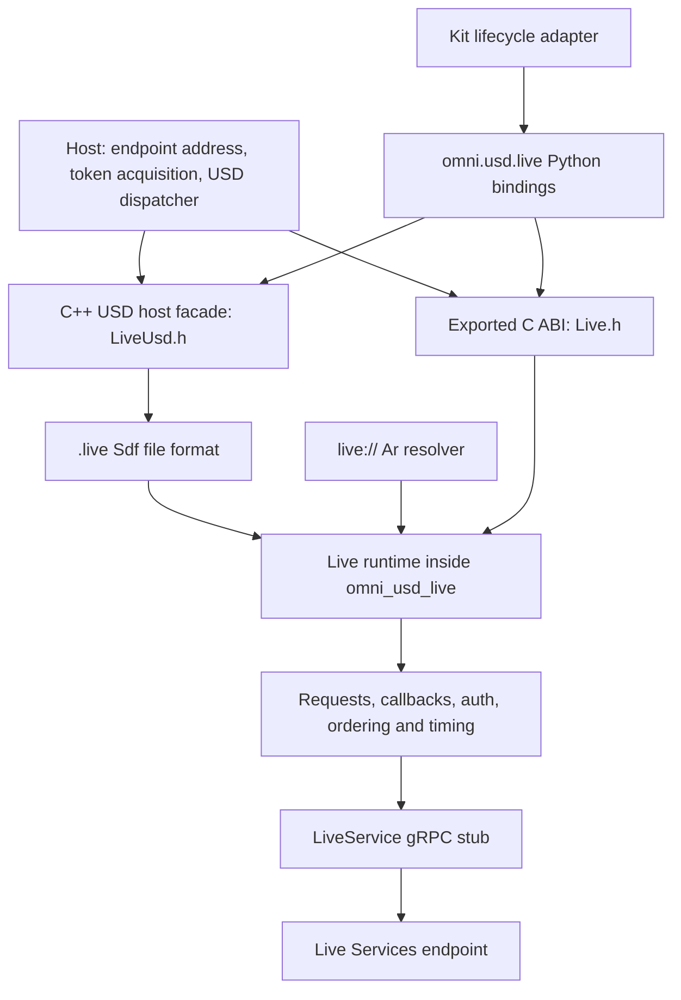

<!-- SPDX-FileCopyrightText: Copyright (c) 2026 NVIDIA CORPORATION & AFFILIATES. All rights reserved. -->
<!-- SPDX-License-Identifier: Apache-2.0 -->

# ovlive design

This document describes the design of ovlive, a USD plugin that lets several processes share one USD layer and edit it together in near real time through a Live Services gRPC endpoint. It is for engineers and agents who integrate ovlive into a host application, run it against a compatible service, or change the plugin itself. It states the behavior that a host and a service observe; [Live.h](../include/omni/usd/live/Live.h) and [LiveUsd.h](../include/omni/usd/live/LiveUsd.h) are normative for exact signatures, and the [support boundary](ovlive-support-boundary.md) records what is qualified and what is open.

## 1. Purpose, audience and scope

A USD layer lives in one process's memory. Live layers let several processes, for example five to ten agents building one scene, share one layer and see each other's edits in near real time. ovlive provides live layers as a USD file format for `.live` layers, an Ar resolver for `live://` URIs and a runtime that talks to a Live Services endpoint over gRPC, all in one shared library, `omni_usd_live`, with a C ABI and Python bindings (`omni.usd.live`).

There are three ways to enter live editing. Each starts from a stage loaded from a base USD file:

1. **Root live editing.** A `.live` layer is inserted into the in-memory session layer, on top of everything. Edits go to it.
2. **Sub-layer live editing.** A `.live` layer is inserted into the layer stack above an existing layer, for example `my-sub-layer.live` above `my-sub-layer.usd`. Edits go to it.
3. **Prim-level observation.** A `.live` layer is inserted into the layer stack for a prim. It shows the live updates of other participants who are root-live-editing that prim's source file. It is read-only, because it is not in the stage's editable layer stack.

**Live layers are in-memory only.** A host opens each live layer with `FindOrOpen`, or creates it with `CreateNew`, on its publication context (section 7) and then inserts it at runtime, into the session layer, a layer stack or a prim's layer stack as above. Live URIs never appear in loaded or saved content: no sublayer, reference or payload in a file names one, and a live layer never references another live layer, directly or indirectly. A host that inserts a live layer into the sublayers of a file-backed layer removes it before that layer is saved or exported. Composing a live URI that the host has not opened is unsupported (section 6).

**Authoring is plain USD.** The host sets the live layer as the edit target and uses ordinary `Usd` and `Sdf` calls. There is no custom edit API, draft, commit or snapshot call for editing a live scene.

Convergence is internal to the file format:

- Your own pending field edits hide peer updates to that field until the service's ordered stream confirms yours.
- Sequence numbers put updates in order.
- Edits to deleted nodes are ignored.
- Stable node identities keep renames and moves working.

Section 8 specifies these rules.

The host supplies a server address and an access token. It owns service discovery, login, token acquisition and renewal, the USD dispatcher on which live layers are opened and authored, session UI and merge policy. The plugin owns authenticated gRPC calls, live layer I/O, sessions, presence, messages, reconnection, request lifetime and delivery of remote content into USD layers. Because the file format and the runtime share one library, the C ABI carries no raw layer I/O: hosts read and write live layers through `SdfLayer`, and the ABI covers lifecycle, endpoints, authentication, sessions, presence, messages, bounded drain, jitter configuration, layer stat and delete, URIs, status and diagnostics. There is one layer implementation; there is no per-layer version argument, host switch or fallback implementation, and the host runs no processing pump.

Out of scope: Nucleus compatibility, Nucleus channels, storage discovery, OAuth/OIDC flows, refresh-token storage, S3/Azure/HTTP file transfer, general filesystem listing, Nucleus checkpoints, a production service implementation and automatic scene merge. A host can keep separate storage and resolver components for the base USD scene; none of them is part of the live runtime's dependency closure, which neither links nor loads `omniclient`, a Nucleus transport or another Omniverse resolver.

## 2. Architecture overview



Each process has exactly one live runtime, owned by the `omni_usd_live` shared library. The USD plugin, native applications that load the library and the Python extension all use that instance: the Python extension links the same library and contains no copy of the runtime or of the generated service code. One plugin metadata file registers both the resolver for the `live` scheme and the file format for the `.live` extension; no second `live` handler ships. The runtime is initialized with `omniUsdLiveInitialize` and released with `omniUsdLiveShutdown`; the USD types the library registers make it process-lifetime, so a host never unloads it while the process may use those registrations, layers or callbacks. Loading the library through USD first or through `dlopen` first yields the same runtime, and the resolver observes the endpoints registered through the C ABI.

| Component | Location | Responsibility |
| --- | --- | --- |
| Runtime | `source/live/runtime` | Endpoints, credentials, requests, per-layer actors, sessions, status, diagnostics and the URI codec |
| Scene | `source/live/scene` | The `.live` Sdf file format, host scene storage and projection, the scene journal, the wire scene and layer creation |
| Resolver | `source/live/resolver` | `live://` identifiers, resolution and write eligibility (section 6) |
| Wire | `source/live/wire` | The OMPF envelope and USD value codec over the vendored delta schema |
| Protocol | `source/live/protos` | The vendored LiveService proto and its generated stub (section 3) |
| Python bindings | `source/bindings/python` | The `omni.usd.live` package over the C ABI and the USD host facade |
| Kit adapter | `source/kit` | Kit lifecycle entry point over the Python package |

[Live.h](../include/omni/usd/live/Live.h) is a USD-free C header with a versioned ABI. [LiveUsd.h](../include/omni/usd/live/LiveUsd.h) is a C++ facade tied to the exact USD, compiler and standard-library ABI of the plugin build; it configures the host's serial publication context, prepares owned layer creations and waits for save barriers. Live layers themselves are read and authored with plain USD.

Transport workers, per-layer actors and the scene journal run on runtime threads and never call USD. Remote content reaches a layer only through jobs that the host's dispatcher runs on the layer's serial host context (section 7). The runtime drives transport, jitter-delayed delivery and application progress on its own workers; `omniUsdLiveWaitForPendingUpdates` is a bounded wait for already admitted work, not a processing call.

Private third-party symbols (gRPC, protobuf, TLS and their dependencies) are hidden behind an export allowlist so the library coexists with the host's copies. Runtime shutdown rejects new work, cancels active RPCs and drains every completion and callback before releasing state, and a timed-out shutdown keeps its state for retry (section 16, `Shutdown`).

## 3. Protocol facts the design relies on

The runtime speaks `nvidia.omniverse.live.v1alpha.LiveService`, vendored from the live edit service in `source/live/protos/nvidia/omniverse/live/v1alpha/live.proto` ([provenance](../source/live/protos/PROVENANCE.md)). The service has ten RPCs and no dependency on storage or notification protocols:

| RPC | Shape | Role |
| --- | --- | --- |
| `CreateSession`, `ListSessions`, `DeleteSession` | unary | Create and list sessions for a base-layer path; delete a session and its layers |
| `JoinSession` | bidirectional stream | Presence and application messages |
| `CreateLayer` | client stream | Create or replace a layer's content; returns a new object ID whose sequence starts at 1 |
| `UpdateLayer` | client stream | Append one update to an existing object; returns its sequence number and server timestamp |
| `DeleteLayer`, `StatLayer` | unary | Delete a layer; read its creator and creation and modification times |
| `SubscribeReadLayer` | server stream | Full content or resume from a known object ID and sequence, then updates |
| `Ping` | unary | Round-trip time and server time for jitter estimation, and the service's capabilities |

The design depends on these properties of the protocol:

- **Operation IDs on layer writes.** `UpdateLayerHeader.operation_id` and `CreateLayerHeader.operation_id` carry an optional caller-generated identity of 1 to 64 bytes of `A-Z a-z 0-9 - . _ ~`, one per logical write. A re-send with the same ID and content after the first attempt committed returns `OK` with the original sequence number and timestamp (update) or object ID (create) and `operation_outcome` `OPERATION_OUTCOME_ALREADY_COMMITTED`; nothing is applied twice. A request that applies its write reports `OPERATION_OUTCOME_APPLIED`. An update re-send after the object was replaced is `FAILED_PRECONDITION`, and after `DeleteLayer` `NOT_FOUND`. Content is the SHA-256 over `layer_name`, one 0x00 byte and the concatenated payload bytes, so chunk boundaries and every other header field do not count; the same ID with another layer name or other bytes is `ALREADY_EXISTS`. An update re-send matches only on the same object, with the same `client_id` and before that writer's next write to the object. A create re-send matches by session and operation ID for 24 hours, also after the layer was replaced or deleted, and then returns the original object ID; the same ID in another session does not match. `OPERATION_OUTCOME_UNSPECIFIED` means no ID was sent or the server ignored it: a server older than operation IDs applies every request, a re-send included. `CreateSession`, `DeleteLayer`, `DeleteSession` and session messages carry no operation ID. A mutation whose response is lost may or may not have committed; the runtime re-sends only a layer write or creation, and otherwise reports `OUTCOME_UNKNOWN` (section 13).
- **Chained writes and capabilities.** `UpdateLayerRequest.chained_header` carries a `ChainedUpdateLayerHeader`: an `UpdateLayerHeader`, `previous_operation_id`, the operation ID of the same `client_id`'s previous write to the object, empty for its first, and `no_wait`. The service commits a chained call only right after that predecessor: after reading the call's content it waits for the predecessor until it commits, the call's deadline passes or the client cancels the call, and a cancelled or disconnected waiting call applies nothing, unless the service had already handed its commit to the store: then it can still be written, after a store reconnect and past the deadline, but only right after its predecessor. With `no_wait` the call commits, is answered `ALREADY_COMMITTED` or is refused at once. A call that cannot commit, at its deadline or at once under `no_wait`, is refused `ABORTED` with `PREDECESSOR_NOT_COMMITTED`, whose metadata names the writer's latest write: `last_record`, which is `absent`, `operation` or `no_operation_id`, and `last_operation_id`. A call already committing checks its predecessor atomically, so it lands only right after it. A replica that does not know the arm sees a request without a header and refuses it `INVALID_ARGUMENT` without an `ErrorInfo` before reading any chunk, so a chained call fails closed, while a chaining replica puts an `ErrorInfo` of its domain, `INVALID_UPDATE`, on every `INVALID_ARGUMENT` it gives a chained call. `PingResponse.operation_ids` and `PingResponse.chained_writes` report whether the service honours operation IDs and accepts chained calls. These fields are the contract agreed with the live edit service, vendored ahead of its own change and reconciled with it when the service and its proto move into this repository (section 20).
- **Object identity and order.** Each layer's content is an object with a sequence number that increases by one per update. `CreateLayer` on an existing layer replaces the object; a subscriber to the replaced object cannot continue on it. The service may coalesce updates, so a read can skip sequence positions that a complete aggregate update covers.
- **Echo suppression by `client_id`.** Updates and subscriptions that share a `client_id` do not echo each other's writes. The runtime uses one writer ID per endpoint lifetime for every layer writer and its read subscription on that endpoint.
- **Catch-up has no flag.** The read stream carries no "latest" marker. The first complete response of a subscription attempt is its catch-up target: a full snapshot, a diff or an empty caught-up header. The runtime reports caught-up (`OK_LATEST`) once, when the layer first catches up, and not again after a reconnect.
- **Ordered delivery.** gRPC delivers each read in order. The service consumes a sequence for an upload without content (service SDD §8.4) and delivers it as an empty diff based at the previous sequence, so a read normally skips no position; the reader also treats a position the read skips as an empty commit, and accepts a header-only frame for one. A read never carries the reading writer's own commits made while it is open; its catch-up delivers earlier ones like any other commit, at their positions (section 12).
- **Microsecond timestamps.** Session and layer creation times, layer modification times and server timestamps are microseconds since the Unix epoch. The runtime keeps wire precision internally and converts to milliseconds only at the ABI (for example `created_time_ms`).
- **Messages are queue-accepted.** `JoinSession` returns a server-assigned connection ID and then peer joined, peer left and peer message events. The join carries an application name but no caller-supplied user name; peer user names come from the service. Sending a message succeeds when the local queue accepts it: the protocol has no peer-delivery acknowledgment, and messages are not durable.
- **Ping may reach another backend.** A `Ping` can be routed to a different backend than the read stream, so clock alignment between backends is a service assumption, and its capability report can come from another replica than the one a write reaches (section 13).

Layer content and updates use the OMPF/FlatBuffers delta encoding, whose schema is vendored unchanged in `source/live/wire/schema`.

## 4. Endpoints, TLS and credential contexts

A host registers an endpoint with `omniUsdLiveRegisterEndpoint` and an `OmniUsdLiveEndpointOptions` record: a **server authority** (`host[:port]`, where host is a DNS name, an IPv4 literal or a bracketed IPv6 literal), TLS settings, an initial bearer token with optional expiry, and an optional authentication wait timeout. The authority is passed to gRPC as the channel target, so gRPC's name resolution, connection management and load-balancing policy apply unchanged; the runtime supplies its own per-method message size limits and ignores service configuration from name resolution. Registration copies every string and returns an opaque endpoint handle. There is no discovery request, storage-root probe or redirect-based credential forwarding.

Transport security follows from the authority unless `transport_security` overrides it:

- **Loopback** (`localhost`, `127.0.0.1`, `::1`) uses plaintext by default, because no certificate can be issued for a loopback name.
- **Any other host** uses TLS with hostname verification. For a DNS authority the certificate is verified against the dialed name; a `tls_server_name`, if given, must equal it. For an IP-literal authority the host must supply `tls_server_name`, a DNS name that the certificate is verified against; registration without one fails with `INVALID_ARGUMENT` rather than disabling verification.
- The host may supply `ca_pem`; otherwise the platform trust roots apply.
- `OMNI_USD_LIVE_TRANSPORT_TLS` or `OMNI_USD_LIVE_TRANSPORT_PLAINTEXT` overrides the default in either direction, for example TLS to a loopback proxy or plaintext inside a trusted test network. The runtime never switches transport security on its own, for example after a TLS failure.

Endpoint identity is the normalized authority (section 5). The authority, TLS server name, CA, transport security and authentication wait timeout are immutable after registration; changing them requires unregistering the endpoint and registering it again. Each successful registration acquires one ownership reference. Registering the same authority again returns the existing handle and adds a reference if the immutable configuration matches, or returns `ALREADY_EXISTS` without acquiring one if it does not. The initial token and expiry apply only when the endpoint is created: a repeated registration never overwrites current credentials, which change only through `omniUsdLiveSetAccessToken` (section 14). An endpoint registered without a token starts in `AUTH_WAIT`.

One authority maps to one credential context, and so to one authenticated principal, in a runtime. A host that needs two principals against one server registers a second DNS alias for it. Each endpoint lifetime has its own writer ID (section 3), so layers opened through different aliases receive each other's edits.

Each owner pairs its successful registration with exactly one successful `omniUsdLiveUnregisterEndpoint`; the final release returns `BUSY` at once while any layer, session, request or endpoint-scoped callback depends on the endpoint, and otherwise closes it, so a later registration of the authority creates a new endpoint with a new writer ID (section 16, `UnregisterEndpoint`).

## 5. Live URIs and portable identity

Live layers and sessions are named by `live://` URIs that carry the server authority, the session ID and, for a layer, the layer name:

```text
live://live.example.internal/<escaped-session-id>
live://live.example.internal:8443/<escaped-session-id>/root.live
```

A URI is self-describing. Any process that has registered an endpoint for the same authority can open it, and it contains neither a token nor a process-local handle, so sharing a session means sharing the URI alone; each host provisions its own credentials. The authority in a URI must match a registered authority exactly after normalization: the host is lowercased and loses a trailing dot, an IPv6 literal takes its canonical compressed form, and the default port 443 is omitted. The runtime does not resolve aliases. The Omniverse storage resolver does not claim the `live` scheme, so the live resolver is the only Ar handler for it even in a process that loads another resolver for storage.

Session IDs are opaque. The codec percent-encodes every byte outside the unreserved set (letters, digits, `-`, `.`, `_`, `~`), so an encoded slash is data inside a session ID. The rest of the path is the layer name: one or more components separated by literal `/`, each percent-encoded, ending in `.live`; an encoded slash inside a layer name is rejected, so nesting cannot hide in an escape. The codec rejects empty components, `.` and `..`, control characters, backslashes, malformed escapes, invalid UTF-8, userinfo, query strings and fragments, and any URI longer than 65,536 bytes. Round trips preserve the session ID and layer name exactly: component boundaries are found before any escape is decoded.

The URI helpers are pure functions that need no runtime or registered endpoint: `omniUsdLiveMakeSessionUri`, `omniUsdLiveMakeLayerUri`, `omniUsdLiveParseUri` and `omniUsdLiveCombineWithBaseUri` in C, and `make_session_uri`, `make_layer_uri`, `parse_uri` and `combine_with_base_uri` in Python. A host never concatenates an unescaped name into a URI.

Session creation and listing take both an endpoint and a **base-layer key**, the service's `CreateSessionRequest.path` and `ListSessionsRequest.path`. The key is an identity, not a transport destination: the host supplies the base layer's canonical URL with query and fragment removed, and turns a signed storage URL into a stable unsigned identity before calling. It does not strip the scheme, authority or path, nor rewrite the URL to a local resolved file name. The plugin passes the key verbatim and never contacts the base layer's server.

## 6. USD integration: file format, resolver, one backing per resource, bootstrap

USD asset resolution can fail before `SdfFileFormat::Read` is called, so a file format alone is not enough. The package registers an Ar 2.0 resolver for the `live` scheme beside the `.live` file format. USD 23.11, the first release with Ar 2.0, is the design's minimum for a future profile; only USD 25.11 is built, and the [build guide](ovlive-build.md) lists its profiles.

**Resolver.** The resolver maps identifiers to canonical live URIs and to the runtime's registered endpoints; it never opens a subscription and never serves a delta stream as file bytes.

- Relative `.live` paths anchor in the anchoring live layer's directory.
- Resolving an unattached layer needs a registered endpoint for the authority and a layer that `StatLayer` finds; an unregistered authority (`NOT_FOUND`), a failed stat or failed authentication fails resolution and never yields an empty asset.
- Resolution of an attached layer uses the attachment as existence evidence and issues no RPC; the first open still stats; a closing backing is not attached.
- A new asset needs only a registered endpoint; the file format admits the creation itself.
- A live layer has no byte-stream form, so opening it as an asset fails with `UNSUPPORTED`.

Every resolver failure posts a USD error with the typed result.

**Relative asset paths.** A live layer's URI is not the base scene's storage directory. The resolver creates identifiers only for `live://` URIs and relative paths ending in `.live`; the suffix match is case-sensitive, so a path ending in `.LIVE` is an ordinary asset. Any other path anchored in a live layer (a texture, payload or ordinary USD file, or an absolute or other-scheme path) gets an empty identifier with no diagnostic and no RPC, so USD reports the asset unresolved. Hosts author ordinary assets relative to a non-live layer or as paths their own resolvers handle, and rebase asset paths with the base layer's resolver context when composing or merging. The live resolver coexists with the host's file, S3, HTTP and other resolvers.

**File format.** `CanRead` accepts a live URI whose layer name ends in `.live`. `Read` runs only on a configured publication context where its `isCurrent()` predicate holds (section 7): without a configured context it fails with `NOT_INITIALIZED`, and elsewhere with `BUSY`. A live layer is therefore opened by its host, never by composition (section 1): USD opens a layer stack's sublayers in parallel on its worker threads, so composing live URIs that the host has not opened fails those opens with `BUSY` off the host, and USD reports each dropped layer only as a warning. The error that a read off the host of a never-attached layer posts says to open live layers on the host before composing them, and USD's warning for the dropped sublayer carries it. File-format arguments and metadata-only reads are rejected with `UNSUPPORTED`, so no argument can select another implementation or allocate a second backing for one resource. A forced reload of an attached layer keeps its attachment and accepted work: the stream already supplies the current content, and the reload reports the layer's failure cause if it has one. `SdfLayer::Save` of an existing live layer and `SdfLayer::Export` to a new live URI take separate paths (section 11).

**One backing per resource.** A process-wide registry allows **one live backing per (registered endpoint, decoded session ID, decoded layer name)**, keyed by canonical URI independently of Sdf's identifier cache. A cached `SdfLayer` open returns more references to the same layer. An attempt to construct a second independent backing for the resource fails with `ALREADY_EXISTS` before it subscribes, creates or authors, and neither replaces the existing entry or status subject nor publishes its failure onto them. The key is reserved atomically before initialization, held through opening, failure and closing, and released only after the backing, its callbacks and workers are quiescent, so concurrent opens cannot both win. A failed open marks its key retiring once its backing is quiescent, exactly as a released layer's closing backing does, so an immediate retry waits for that release within its own deadline instead of receiving `ALREADY_EXISTS` at once. An open, or an `Export` to the resource, that finds the key held by a closing backing whose layer was released, or by a failed open, waits for the key's release within its own deadline and then proceeds; a deadline that passes first returns `ALREADY_EXISTS`, and a backing that an owner still holds after closing it is refused at once. A closing backing releases its key only after its host publication job retires, so when the host still holds a queued publication of the old layer (a peer update, or the layer's own admitted edits, queued just before the release), the open fails at once with `ALREADY_EXISTS` instead of waiting on its own host, and succeeds after that layer reports `CLOSED`. The rule keeps URI-based status and recovery lookup unambiguous and makes the per-endpoint writer ID safe: two backings for one resource would filter out each other's writes.

**Bootstrap.** Opening subscribes once with object ID and sequence zero. `StatLayer` supplies metadata, not object identity. The layer adopts the subscription's object ID only after it retains complete, validated initial content; an empty caught-up header, an incomplete payload or a stale generation cannot establish it. After adoption, reconnects resume on that object and a replacement of the object is terminal. The open succeeds once the initial content is installed, and that completion is latched, so later incoming work never extends the synchronous open; it fails after `initial_open_timeout_ms`. No local edit is admitted before adoption, and a missing layer, an authentication failure or malformed content never publishes a successful empty layer. Once attached, the file format grants the layer edit permission with `SetPermissionToEdit(true)`.

## 7. Host concurrency and scheduling contract

A live layer's backing is the plugin-owned `HostSceneProjection`, the `SdfAbstractData` that holds the host's current content for that layer. For concurrency it has stock `SdfData` semantics: the host serializes its authoring against reads of the layer exactly as it does for any other layer (in Kit, through the USD lock), and the plugin promises nothing beyond what stock `SdfData` permits. The backing refuses the one overlap it can detect: a mutation that begins while a read, or another call, holds the same layer's storage is refused before any change, and USD passes `omni::usd::live::LayerOperationRejected` with `BUSY` to the authoring caller. The guard loads the read depth once, so any other overlap, such as a read that begins during a mutation, is an undetected race outside the contract. Reads that overlap one another and retire in any order leave no state that refuses a later mutation. Beyond that guard, the plugin's only synchronization is the atomic swap that installs peer content, and that swap runs in a job the host dispatches.

**Publication context.** The host configures a serial host context with `setPublicationContext(dispatch, isCurrent)` or an owned `createPublicationContext` in [LiveUsd.h](../include/omni/usd/live/LiveUsd.h). Both callbacks are required. The configuration applies to future opens; existing layers keep the context they opened with, and clearing or replacing it does not establish quiescence. `FindOrOpen`, `CreateNew` and every dispatched job run on that context. A host inserts a live layer into a stage only after it has opened the layer there, so composition finds the layer already open and never reads it (section 1). The dispatcher must enqueue without waiting, and a job must never run until the enclosing USD call, its synchronous notices and any enclosing `SdfChangeBlock` have returned, including during nested event-loop pumps. An accepted job must run or release its captures. The executor must keep progressing while a save called off the context blocks.

**Jobs.** Two kinds of job install content. A **flush job** compiles the layer's host edit buffer into updates of whole host turns and admits them; a **publication job** installs remote content or a layer's own admitted intent; one publication job installs a batch of queued peer updates (section 12). Each runs outside any enclosing change block and finishes its own change block and synchronous notices before it completes. The runtime bounds a layer's own publication jobs to one outstanding at a time, and `dispatchingLocalPublication()` lets a dispatcher that meters host jobs recognize them. Section 8 describes the buffer and the intents. A dispatcher that refuses a flush job for capacity leaves its buffer pending and the layer `BLOCKED` (section 8); a refused publication job fails its layer.

**Notices.** A layer's first installation replaces its whole content and sends USD's `LayerDidReplaceContent`; a reset snapshot and a replacement of the layer's object are accepted only at bootstrap (section 12), and recovery reopens the layer (section 13), so each of them is a first installation. Every later publication job keeps the layer's backing, reseats its content in place and sends per-path notices for the difference between the host content and the journal's visible scene, which includes the replay of pending intents (section 8), inside the job's one change block: a removed spec as a removal, a renamed or reparented spec as a move, a created spec as an addition, and a changed field as an info change with its old and new value. A field changes when its projected value does: floating-point content, including time-sample keys and layer offsets, compares by representation, so a zero that changes sign or an offset within USD's comparison tolerance is a change and the host content keeps the exact keys and values of the visible scene. Removals and additions are reported as significant, as a host's own non-inert edit is, so a `UsdStage` resyncs exactly the created, removed and moved paths and treats a field edit as an info-only change. A path change that one move cannot state, such as two specs exchanging names, is a removal and a creation. The notices come from USD's own primitive Sdf edits through the layer's state delegate while the backing changes and records nothing, so publication never writes into the host edit buffer, and a notice handler that mutates the layer still fails it (Authoring). A publication with no difference and the same source format, such as that of the layer's own admitted edit, changes nothing and sends no notice: the host content and the baseline it was compared against stay as they are and stay equal, the next flush compiles against that baseline, and the journal replays the edit onto its visible scene. A batch that fails publishes nothing. The difference is computed by section identity over the sections the two scenes do not share: successive scenes share the structure of their section and path indexes and their unchanged sections, so the comparison skips everything between them that no update changed. The new content shares the old content's unchanged spec records and index structure, so a publication's host cost is proportional to the specs it changes, with a logarithmic factor in the layer's spec count, and its USD recomposition follows the changed paths only.

**Authoring.** A live layer may be authored wherever the host's `isCurrent()` predicate holds. The plugin assumes no particular thread: the host defines the predicate and qualifies its writers against it, and detection is only as strong as the predicate. The Python host bridge's predicate holds on the thread that created its publication context, and Kit's is that bridge's: it holds on the Kit main thread, where the extension creates its context, so a Kit worker thread is not a supported writer, even under the USD lock. The plugin calls the predicate once per recorded mutation, so it must be cheap. Mutating a live layer where the predicate does not hold, or from a handler for a notice that a publication job sent, is unsupported. The plugin detects such a mutation when the layer records it and moves the layer to `FAILED` with `UNSUPPORTED`; the edit stays in the host content and the host edit buffer, and the layer stays exportable with `SdfLayer::Export`.

**Opening waits.** An open or `Export` on the host waits, within its deadline, for its initial content and for a closing backing of the same resource to release its key (section 6). Neither wait runs on an operational worker, which gets `BUSY`, and neither waits for a job queued on the waiting host.

**No frame pump.** The host never calls a processing function or ticks the runtime per frame. Stage recomposition, notices and edit-target changes follow the host's ordinary USD rules for any layer.

## 8. Authoring and reconciliation model

A host authors a live layer with plain USD on its serial host context (section 7). The plugin captures each mutation at the backing, turns host turns into updates of whole turns, and reconciles pending local work with the service's ordered stream without losing an accepted local edit.

### Convergence rules

These four rules, stated briefly in section 1, hold for every live layer:

1. **Own pending edits hide peer updates until confirmed.** The visible scene is the authoritative scene plus a replay of the layer's pending intents, so a pending local field edit hides a peer's update to that field until the ordered stream applies the intent's own confirmed effect. An intent retires only then, never on an acknowledgment alone.
2. **Sequence numbers put updates in order.** Authoritative state advances only along the contiguous sequence frontier of the layer's object (section 12).
3. **Edits to deleted nodes are ignored.** A field or sample edit whose target section a committed peer delete removed is **superseded**: replay drops it without a conflict, and the layer reports no failure (section 10).
4. **Stable node identities keep renames and moves working.** Every spec is a section with a stable ID that renames and moves keep; path equality never establishes identity (section 9).

### Authoritative, visible and host state

| State | Content |
| --- | --- |
| Authoritative | The scene at the contiguous applied service frontier |
| Pending intents | Ordered, immutable captured intents, each owning its compiled wire bytes, its original operation log and the journal revision it was compiled against |
| Visible | The replay of the pending intents onto the authoritative scene |
| Host content | The layer's `HostSceneProjection` storage: the last installed visible scene plus host edits that no flush has admitted |

The plugin builds candidate authoritative and visible states separately and publishes both, with the intent ledger, as one transaction; an allocation, decoding or validation failure keeps the previous scene and all admitted work. Equal values and A→B→A edits never establish which intent committed; only the ordered stream does. An intent whose outcome is unknown stays pending and fails the layer (section 13). An intent that cannot be replayed is never silently dropped unless it is superseded. The visible scene is built once per transaction: every pending intent applies in order to one working copy of the authoritative scene, which is materialized once. A pending intent the service predictably rejects as a whole, a Create of a live identity, applies none of its effects; a pending Reorder that names a child a peer has since removed or moved ignores it and orders the children it still names, exactly as USD's `SdfApplyListOrdering` does per child list and as a delivered Reorder applies (section 10). Only an intent holding a Create saves the working scene before it applies, which shares the working scene's structure and costs constant time. Each replayed intent is charged its own records and the sections they change, plus, when it changes structure, a derivation of the paths of the sections it moves and their subtrees and of the shadowing among their siblings, never a copy, measurement or materialization of the scene per intent. A working scene shares the sections, indexes and Sdf storage of the scene it starts from, and materializing it measures and stores only the sections the transaction changed. The field and metadata limits hold on the working scene after every intent, as they hold on each candidate when every intent builds its own, so an intent that exceeds one fails the replay even when a later intent erases back under it. The encoded-value limit is checked once, on the final scene, because measuring values after every intent would re-encode each changed section's values each time; an intermediate scene can exceed it only by values the intents carry, and the pending-byte and replay-byte quotas bound those bytes.

A transaction derives the visible scene from the previous one wherever that equals the replay, so admitting an intent or applying an update costs what applying that intent or update alone costs, never work in proportion to the number of pending intents. An admission applies the new intent to the previous visible scene, the replay's last step. A batch that only confirms leading intents the visible scene applies keeps that scene, because applying a confirmed intent to the authoritative scene is the replay's first step. A batch whose peer updates come before its acknowledgments and hold only field and sample records, with no child field or source format, applies those records to the previous visible scene, except a record of a section the authoritative scene lacks, a field record a pending intent the visible scene applies writes again, and a time-sample record of a section whose whole map such an intent replaces (convergence rule 1). Every other batch replays every pending intent: one with a structural command or a diff, an absorbed acknowledgment, a peer update after an acknowledgment, a confirmed intent whose rejection the replay predicted, or a peer time-sample record of a section a pending intent writes individual samples of, since those merge key by key. To decide, the journal indexes the field and time-sample targets of the pending intents the visible scene applies, and keeps upper bounds of the field count and metadata bytes of every scene the replay passes through. A peer record a pending intent hides counts toward those bounds like one that shows, since it lies in every replayed scene before that intent; only a record of a section the authoritative scene lacks reaches no scene. A peer update that could take one of those scenes over the field or metadata limit, or whose derivation fails, replays every intent instead, so a derivation never changes a transaction's outcome.

### Capture and flush

`SdfChangeBlock` offers no admission, veto or rollback hook, and layer notices arrive after the mutation, so the plugin captures authoring at the backing, never from notices. Every mutation that reaches the projection is applied to storage and recorded into the **host edit buffer** as the original operation: a field, dictionary-key or single-sample edit, or a one-spec create, erase or move. Each record is bound to the section identity it addressed when captured, so deleting section ID 2 at `/P` and creating section ID 9 there never redirects an edit meant for section ID 2. The record is reserved before the storage edit, so every stored edit is recorded, or the layer fails (Failure containment).

Every record requests a **flush job**; at most one is queued, and it runs only after the enclosing USD call and any enclosing `SdfChangeBlock` return, so a host turn is never split across updates. The flush compiles the buffer against the projection's baseline and admits the result once as one **captured intent**. The compiler also reports the **verified candidate**, the baseline plus this intent checked against the captured storage, and the projection rebaselines to it. An empty result issues nothing, and so does a buffer whose every record addresses a section a committed peer delete removed.

**Coalescing.** A layer's admitted writes, in flight and queued, never exceed its issuance window (section 13): one write on an endpoint that does not chain writes, otherwise the chain's window. At most one admitted write waits to be issued, so turns admit no faster than the worker issues them: each admission costs a compilation and a replay of pending intents, which a host authoring many cheap turns a frame would otherwise pay per turn while several writes are still in flight. While an admitted write waits to be issued or the writes fill the window, a flush job, and the flush a publication job runs before it installs peer content, defers without compiling, and later records keep collecting in the buffer; a deferred publication installs once a flush admits the buffer. Once a write is issued or settles, the layer requests the flush, and the buffer compiles into one update that holds every whole turn buffered since the last update, so a writer sends one update per freed slot however fast it authors, and a turn is never split. A deferred turn costs one recorded turn end, so a long stall costs one compilation when a slot frees. Saves admit at once, beyond the window. The host's own notices fire when it authors and an admitted intent fires none, so no notice is merged, delayed or retracted; peers receive one update covering several turns. When the buffered turns, coalesced or authored in one frame, exceed a compile limit together, the service's entry limits, `max_update_bytes` or the 65,536 operations included, the flush admits the most whole turns that fit: the turns whose records stay under the 65,536 operations are admitted at once when they fit, and otherwise compilations that admit nothing find the prefix by doubling the turn count from one and then bisecting at the turn ends, so the cost follows the prefix that fits rather than the buffer, and requests another flush for the rest, so merging never fails a flush that admitting each turn alone would not; a single turn over a limit fails as Failure classes describes. A prefix of the buffer compiles without the host's capture and is verified against its own operations replayed onto the base; the rest is verified against the capture when it compiles. The [`layer_writes`](ovlive-diagnostic-schema.md#layer-writes) metrics count the USD calls and change blocks each admitted update holds.

A buffer compiles and is checked at its footprint. Identities resolve through the baseline's path index, and the compiler tracks the paths the buffer creates, erases and moves a spec from or to. A buffer of field, dictionary-key and sample records, with no structural record and no child-field record, skips namespace planning, since its plan is empty. Otherwise the namespace plan reads and updates only the identities the buffer creates, removes or moves, the baseline children of the paths it vacates or replaces, and the sections each planned command changes, and emits the commands a plan over the complete graph would; it validates the identities the buffer places and the baseline children whose parent identity changes, while the rest of the baseline graph is the service's and stays as it is. Child order is normalized only for the parents whose children, child fields or planned child lists can differ from the baseline's: those the buffer addresses, creates, erases or moves a spec under or away from, and those a planned command changes. The capture of host storage shares the storage's immutable spec records and index, the compiler's replay store shares the baseline's storage, and both are compared with the candidate at the paths the buffer addresses or moves a spec to and at the specs the candidate changes from the baseline, after the capture's spec count. Host storage equals its baseline plus its buffered records, because every stored edit is recorded and every flush rebaselines on the candidate it verified, and the replay store and the candidate differ from the baseline only at those paths, so that comparison covers the whole layer. Such a turn's cost, through compilation, admission, the acknowledgment's application and its publication, is proportional to its records, the specs they address, the subtrees it moves and the children lists of the parents it changes, plus the records of the other pending intents that admission and application replay, with a logarithmic factor in the layer's spec count.

Time-sample authoring compiles exclusively to individual sample records. Replacing or erasing a whole map emits tombstones for observed keys it removes and values for the replacement keys; unseen concurrent peer keys survive. Repeated writes to one sample in a buffer collapse to its last value, and repeated writes to one field of one identity, including dictionary-key edits of it, collapse to one record of its last value at its last write's position, including across a move or rename of that identity, because an update applies every structural command before its field records and a field's last record wins ([application phases](#application-phases)); a write before an erase is dropped with the erased identity, and writes after a path is recreated address the new identity's own record, while the captured intent retains the complete original log. A collapsed value equal to the baseline's is still emitted. The compiler's replay store skips a whole-field write, other than of `timeSamples`, that the next operation on the same field writes or erases whole again before any structural record, since nothing reads the value between them; the write still collapses into its record and is charged like every other operation. The service persists ordinary fields and samples independently, so `timeSamples` is never emitted as an ordinary field. Dictionary-key edits lower to whole-field replacements, so there is no per-key merge; single-sample edits keep their narrower semantics. Identities created and removed within one buffer compile to nothing, and records inside a subtree the same buffer deletes are dropped so that only the Delete compiles. A buffer that would need several updates, a change of an existing identity's type, and a plan that needs temporary Creates to break a move cycle are unsupported and fail the flush.

Rescheduling is event-driven; there is no timer. A buffer that a transient failure left pending flushes again on its next record, on attachment, on a publication job of its layer or an advance of its journal frontier (an acknowledgment or peer content), on any pending-byte release on its endpoint, on a save, and, when an allocation failure deferred it, on a mutation the buffer bound refuses. A publication job flushes before it installs and defers installation while the buffer stays non-empty, so peer content never overwrites unflushed host edits and neither is dropped.

Admission reserves endpoint pending bytes for both the retained intent and its wire buffers, about twice the update size, so an admitted intent is never refused at issuance. No flush merges or recompiles an admitted intent; section 13 describes its issuance.

Releasing the last reference closes the layer; unadmitted records are discarded and reported by the CLOSED status count and [`host_edits_discarded`](ovlive-diagnostic-catalog.md#discarded-host-edits). A flush job queued before the release finds no layer and does nothing, and close never waits for one, so a host saves or drains before releasing a layer (section 19).

### Failure classes

| Outcome | Causes | Result |
| --- | --- | --- |
| Transient | `BUSY` before publication activates; `CANCELLED` while the attachment closes; `RESOURCE_EXHAUSTED` from the pending-intent limit, from a byte or replay charge that fails only beside other pending work, or from an allocation failure or from a host dispatcher's capacity refusal of the flush job | The buffer stays pending; the layer is `BLOCKED` with the cause, and its buffered edit count is nonzero unless the refusal came through the shared endpoint budget or a capacity refusal of a flush requested while the buffer was empty; the next flush compiles the buffer once, with later records |
| Definitive | A malformed or unsupported compile; a limit the buffer alone exceeds (a compile limit or the service's entry limits, `max_update_bytes`, the whole endpoint or journal quota); a stale captured child order a peer invalidated (`INVALID_ARGUMENT`) | The layer is `FAILED` with the typed cause; nothing is issued; host content keeps every edit for `SdfLayer::Export` |

Once the layer is `FAILED`, flush jobs do nothing and no record is ever admitted; the buffer only counts edits, because host content already holds them for export.

### Quotas

The host edit buffer is bounded by bytes, not records, so a frame can author as much as the endpoint's budget allows, however many change blocks it holds and whether or not the host runs a job between them. Each record is charged an estimate of what the buffer retains for it: the record itself, two turn-boundary entries and an estimate of its value's heap bytes: string and asset path characters; each array, vector and list operation item at its type's size and at least 16 bytes, plus its own characters or nested value; and 64 bytes for each dictionary entry, time sample and variant selection, plus its key characters and value. Paths and names are interned by USD and charge nothing of their own. Every layer's buffer on an endpoint is charged to one shared budget of `max_pending_bytes_per_endpoint` (default 1 GiB), so many layers cannot each buffer that much. Each layer's own buffer is also capped at 1 GiB, that option's default, so a buffer no endpoint budget charges, such as a created layer's before activation, stays bounded; a single layer on an endpoint configured above 1 GiB therefore still buffers at most 1 GiB. The budget is separate from the transport reservations of the same size that section 9 describes: a transport reservation never counts buffered bytes, so a full buffer never blocks its own update's admission or a peer read, and an endpoint can therefore retain about twice `max_pending_bytes_per_endpoint` plus one started host turn per layer: buffered host edits up to the budget plus each layer's turn in progress, and transport up to the budget. A host turn ends at the change notice that follows each USD call or change block, and when a flush attempt ends, so the bound applies to every call whether or not the host has run the flush job; a new host turn starts only while the endpoint's buffered bytes are below the budget, and mutations inside a started turn always record, so every USD call is recorded whole. Stock `SdfLayer` sends its change notice before editing, so a refused edit still sends one. A mutation that would start a new host turn once the budget is exhausted is refused before it changes the content or the buffer: the projection posts a USD runtime error that names the bound, the endpoint's buffered bytes and `max_pending_bytes_per_endpoint`, and throws `omni::usd::live::LayerOperationRejected` with `RESOURCE_EXHAUSTED`, and the layer is `BLOCKED` with that cause until a flush admits; a refused layer whose own buffer is empty flushes again on the next release of buffered bytes on its endpoint, which clears the cause. Off the host context the refusal carries `UNSUPPORTED` and fails the layer; a `FAILED` layer's buffer is discarded, releases its charge and never refuses a host-context edit.

The flush after a frame compiles the buffer into as many updates as the compile limits require, the service's entry limits, `max_update_bytes`, the compiler's 65,536 emitted operations, with repeated writes to one field or sample counting once, and its 1,048,576 operations counting every write included, each holding the most whole host turns that fit (Coalescing), so a frame of 1,000 change blocks of 150 attribute sets reaches the service as a few updates and is never refused. The issuance window admits a few of those updates at a time and the rest stays buffered, bounded by the same budget. The compiler refuses a log of more than 1,048,576 operations before any per-operation work, so compiling a buffer costs a bounded amount before its collapse is known, and the split search compiles no prefix over that bound; a prefix within it may hold far more than 65,536 writes and still fit once they collapse. A single host turn over a compile limit still fails the layer with `RESOURCE_EXHAUSTED` (Failure classes).

Each layer's journal admits at most 4,096 pending intents, 256 MiB of pending intent bytes and 512 MiB of replay bytes and replay work, charged across the whole transaction. An intent is charged for what it alone retains: its wire bytes and its original operations' paths, names and encoded values with per-element and per-record overhead. No intent retains a scene: the base it was compiled against and the host's sealed copy are compilation inputs only, and replay builds from the journal's authoritative scene and the intents' bytes. The pending-byte quota therefore bounds what pending intents retain and is proportional to the edits, so N small edits of a large layer cost about N times an edit, never N times the layer. Compiling and replaying an edit that changes structure each do work in proportion to the scene, so the replay-work and compile-work budgets also hold 32 retained charges of the current scene: an estimate of one representation, its encoded values plus 16 bytes per value element, its names and paths, and per-section and per-field overhead. Budget limits never evict accepted work.

An admission's replay work holds, beside the new intent's, the work of each pending intent's step in a replay of every pending intent, measured when the visible scene last applied it. Each step keeps the working scene's paths, child groups and children lists current, deriving only what its intent changes (section 12), so a step's work does not depend on the steps before it and the new intent's step costs what it costs in that replay. The quota therefore bounds the replay of every pending intent that a later batch can need; a transaction that derives the visible scene from the previous one is charged only the work it does.

A layer is as large as the service holds. No default caps its sections, fields, names, paths or value elements, and a single update's envelope and value budgets sit above anything admission lets in, since decoding is linear in its input. Each update may also do work proportional to the previous scene and its own records, beside the configured graph work. Creating a layer charges the created scene's retained estimate to the endpoint budget, so `max_pending_bytes_per_endpoint` bounds the largest layer a host can create.

**Service entry limits.** The live edit service refuses a delta that holds more than `MAX_DELTA_ENTRIES` (99,999) struct commands, set fields and time samples together, and a child reorder whose list names more than 100,000 sections; the list is outside the entry count, and the Reorder itself is one struct command. Its FlatBuffers verifier admits at most 100,000 tables, the delta's root and one per command, field and sample, and refuses a larger delta with an opaque error; its explicit check refuses `INVALID_ARGUMENT` with a `google.rpc.ErrorInfo` of domain `nvidia.omniverse.live.v1alpha`: `DELTA_TOO_LARGE` with `struct_commands`, `set_fields`, `time_samples` and `max_entries`, or `CHILDREN_LIST_TOO_LONG` with `limit` and `actual`. That refusal is definitive and fails the layer, so the compiler counts every update exactly as the service does, against the service's limits, and never issues one over them. A turn is never split: an update holds one or more whole host turns under one operation ID. A flush over the limits is a compile limit like the 65,536 operations above: it fails the layer with `RESOURCE_EXHAUSTED`, a USD runtime error names the counts in the ErrorInfo's terms, and host content keeps every edit for `SdfLayer::Export`, so a host that authors in bulk saves between chunks. A creation seed over the limits fails before any `CreateLayer` (section 11). When a service with lower limits refuses an update or creation anyway, the attempt's `rpc_failed` diagnostic carries the ErrorInfo's reason and counts ([diagnostic catalog](ovlive-diagnostic-catalog.md#service-entry-limits)).

### Whole-content operations

Host `CopyFrom`, `TransferContent` and `Import` into a live layer are rejected before mutation with `UNSUPPORTED`, leaving content and status unchanged: `CopyFrom` and `TransferContent` throw `LayerOperationRejected`, and `Import` returns false with a USD runtime error. Importing an attached layer's own path is a forced reload that keeps the attachment, its buffer and its pending intents. `SdfLayer::Clear` swaps in fresh backing without a mutation hook, so it cannot be rejected: the plugin detects the swap and fails the layer, and the cleared content is lost. Any other backing swap fails the layer with `UNSUPPORTED` and keeps the swapped-in content exportable. An opened layer gains `SetPermissionToEdit(true)` when it is attached; a creation layer, at activation (section 11).

### Failure containment

`omni_usd_live` keeps host authoring from aborting the application or corrupting USD bookkeeping, except for an allocation failure inside USD's own code (below), with unmodified USD SDK binaries and no application guards around live roots. USD's data mutation hooks return void, so every rejection happens before the projection's storage changes, never by undoing a mutation USD has bookkept. Four invariants hold, beside the quota refusal (Quotas) and the whole-content rejections (Whole-content operations):

- **Typed pre-change rejection.** A rejection before any change throws `omni::usd::live::LayerOperationRejected`, a `std::runtime_error` whose `result()` is the typed cause, so a host that catches `std::exception` continues with content and status unchanged. `CopyFrom` rejects every source with `UNSUPPORTED`; storage rejects a NaN time sample (`INVALID_ARGUMENT`), a foreign value it cannot extract (`UNSUPPORTED`) and a write while a read or another call holds the storage (`BUSY`); each also posts one USD runtime error. A mutation that begins while a forwarded call on the same projection is in progress is refused with `BUSY` and posts no runtime error.
- **Allocation failures propagate unchanged.** An allocation exception from a storage edit removes that edit's record and propagates as is, and an allocation failure while a live layer opens, before its first RPC, fails the open with `RESOURCE_EXHAUSTED` or propagates the allocation exception, and releases its admission, status subject and endpoint reference. Plugin storage cannot roll back an allocation failure elsewhere in a USD compound operation, and one inside USD's own code, such as its change-notice delivery or destructors, can terminate the process, leave the composed stage out of step with layer data or, inside `SdfLayer::FindOrOpen`'s registry lock, deadlock; stock `SdfData` layers behave the same. An allocation failure inside USD's own layer constructor leaves USD's layer registry holding a dead entry, and a later layer of that identifier aborts inside USD; the runtime cannot prevent it.
- **An unrecordable edit is kept and fails the layer.** A foreign value whose second extraction fails after the storage edit keeps the edit and fails the layer with `UNSUPPORTED`, without a throw; if that second extraction throws, the edit is kept, the layer fails with the mapped cause (`RESOURCE_EXHAUSTED` for an allocation failure, otherwise `INTERNAL_ERROR`) and the exception propagates.
- **The `FAILED` latch is sticky.** The first host failure cause (an unsupported flush, authoring where `isCurrent()` does not hold, a notice-time mutation, a backing swap) is latched atomically; later causes never replace it, and latching neither allocates nor calls back. It reports through typed status and callbacks, independently of diagnostic sinks.

Notice-time mutation is unsupported because reentrant writes during change-notice delivery can produce USD threading violations and leave backing and stage composition disagreeing; an ordinary USDA layer reproduces this. The runtime never silently discards, transmits, acknowledges or retries local work.

The [allocation and edit-boundary probes](ovlive-testing.md#allocation-and-edit-boundary-probes) reproduce these USD boundaries on a given SDK.

## 9. Wire model: section graph and application phases

Layer content on the wire is a graph of sections encoded as OMPF deltas (section 3). The plugin keeps that graph beside the exact Sdf scene and publishes both in one transaction (section 8).

### Sections and identity

Each section has an ID, a parent ID, a spec type, a relative name, a sibling ordering key and fields; a derived index maps IDs to paths. ID 1 is the pseudoroot at `/`, with parent 0. A Create attaches a new section and appends it to its parent's order; a Delete removes the section and its graph descendants; a Move keeps section IDs and values while changing the parent or name and recomputing the paths of the whole subtree. Descendant paths are recomputed through USD's child policies, not by substring replacement, because a graph descendant need not have its parent's ordinary Sdf path prefix: a VariantSet `/P{v=}` is the graph parent of Variant `/P{v=x}`.

Section IDs are client-allocated, full-width random 64-bit values. New IDs exclude 0, 1 and every ID observed or allocated for the object, including retired ones. That history survives reconnect, is never evicted, holds at most 67,108,864 IDs and resets only on layer replacement; admission fails when it is full. Random IDs give probabilistic uniqueness only (section 10).

### Child lists

Child-list IDs are relative to the parent's spec type and name `SdfChildrenKeys` fields; they are not `primOrder` or `propertyOrder` metadata:

| Parent type | List 0 | List 1 | List 2 |
| --- | --- | --- | --- |
| PseudoRoot | PrimChildren | — | — |
| Prim | PrimChildren | PropertyChildren | VariantSetChildren |
| Variant | PrimChildren | PropertyChildren | VariantSetChildren |
| VariantSet | VariantChildren | — | — |
| Attribute | ConnectionChildren | ExpressionChildren | MapperChildren |
| Relationship | RelationshipTargetChildren | ExpressionChildren | — |
| RelationshipTarget | PropertyChildren | — | — |
| Mapper | MapperArgChildren | — | — |

Other parent types have no child lists. ConnectionChildren, RelationshipTargetChildren and MapperChildren hold path vectors; the others hold token vectors. Variant parents carry VariantSetChildren at list 2, as Prim does, because stock USD supports nested variant sets such as `/P{v=x}{w=}`; variant names use USD's variant-specific validation, so names such as `1` and `high-low` survive.

`DiffChange.sectionOrder` is the section's index in its parent's current children list. A diff restates only changed sections, so an unchanged sibling can hold an index from an older list; the client inserts each restated section at its index among the parent's other children, in index order, renumbers them, and rebuilds child fields from the result. A Reorder carries the parent's complete children list, naming each child once, which a service may store verbatim (section 20), so the client emits a complete list or no Reorder, and only when ordering differences remain after structural planning: appending C to [A,B] needs none. An incoming Reorder orders each child list it names on its own, as USD orders a prim's children by `primOrder` and its properties by `propertyOrder`, and as the live edit service orders a stored list; its child-list ID plays no part. The reader splits the parent's current children by child list and applies the Reorder's list to each list it names exactly as USD's `SdfApplyListOrdering` does: IDs that are not members of that list (another list's children, non-children, unknown IDs) are ignored, and so is every repeat after an ID's first occurrence; the first occurrence of each named child, in list order, moves to the end with the unnamed siblings of its list that follow it, and unnamed children before the first named one stay in front. The result fills the positions that list holds among the parent's children, so a list the Reorder names no member of keeps its order and positions: children `[A, x, B, y]` (prims A and B, properties x and y) ordered `[B, A]` become `[B, x, A, y]`. A list naming every member of a child list leaves that list in the list's order whatever the interleaving of the kinds, so the complete list the client emits gives every reader each list's order, and only a partial list, such as one from a client that sends one child list, depends on the rule; the reader keeps every child either way.

### Application phases

An update applies in three phases: structural commands in wire order, then field records, then per-time-sample records, keeping record order within each phase. Repeated writes to one key in a phase take the last record. An empty top-level value erases a field or sample; `SdfValueBlock` stays an authored value. A whole `TimeSamples` replacement followed by individual sample records therefore starts from the replacement map. Published notices observe the complete new scene, never an intermediate state.

Structural commands update graph membership and only the child fields they affect. For an explicit child-field key, its last record supplies the final order and must name every final graph member exactly once; a contradictory final record fails the whole candidate.

A diff describes final section metadata. All `DiffChange` upserts and `DiffDelete` removals are staged before the final parent graph and paths are resolved, so a descendant that another change moves elsewhere survives its old ancestor's deletion. A diff with `baseVersion` 0 builds a fresh authoritative graph and replaces all previous authoritative content, including on first load; it never discards local intents or authorizes applying them to a replacement object.

### Values and limits

Wire admission validates the whole OMPF envelope and every USD value against the version-zero type table and shared batch limits before it builds a candidate scene. An invalid or unsupported value fails explicitly; it never becomes a deletion or a batch applied in part. Type 0 is the exception: Kit writes a value of a type outside the table, scalar or array, as type 0 with no body, so it decodes as an empty value, which erases a field or time sample and is omitted as a dictionary entry. Incoming values may contain infinite time-sample keys; NaN keys are invalid. Outgoing sample records require finite times because the service rejects nonfinite keys. Asset paths keep their authored expressions and identifiers; resolved values never replace that text.

Some USD values have no version-zero encoding. A payload with a non-identity layer offset (including nested, array and list-operation occurrences), a value of a type outside the version-zero table such as `SdfRelocates` or `SdfPathExpression`, a nested empty value, and an unregistered value other than a string, dictionary or `SdfUnregisteredValueListOp` fail the flush as unsupported, and host content keeps the authored value for export. The typed status stays `UNSUPPORTED`. A flush that fails for one of these reasons, 1 value type, 2 payload offset, 3 identity type change, 4 multi-update, 5 move cycle, 6 time-sample dictionary key (a dictionary-key edit of `timeSamples`) or 7 identity realization (a namespace change that identity-preserving Create, Delete and Move commands cannot realize, such as a mapper with a relative target), posts a USD runtime error on the host that names the layer and reason, plus the path, field and value type of the operation when a single operation causes it, and emits the [`flush_unsupported`](ovlive-diagnostic-catalog.md#unsupported-flushes) diagnostic, which carries only the reason code. A compiled edit that conflicts with the current scene when it is replayed onto it also fails the flush `UNSUPPORTED`, with the typed status only.

`CreateLayer` and `UpdateLayer` send one header and then chunks of at most 2 MiB; a read assembles exactly `total_size` bytes before dispatch and discards an incomplete payload on reconnect. An update the layer sends is bounded by `max_update_bytes` (default 100 MiB, the service's default upload limit); a read update, such as the catch-up snapshot of a large layer, and an endpoint's retained work are bounded by `max_pending_bytes_per_endpoint` (default 1 GiB). Each finite RPC reserves its response allowance from that budget first; a refusal is a local `RESOURCE_EXHAUSTED` with no RPC. Backpressure pauses or fails submission visibly; it never drops an authored delta or an acknowledgment that sequence progress needs. Incoming updates pause the layer's read instead (section 12, incoming pacing).

## 10. Concurrent-edit semantics and known limitations

The service defines how concurrent edits resolve, and the independent reference service models the same rules (section 20). The client follows them: it never guesses a different winner, skips records to advance, or turns a conflict into a fresh `CreateLayer`. Visible state follows the authoritative graph, and none of the cases below fails a layer unless stated.

**Same field.** When two writers set one field, the service orders their updates and the later sequence wins. Each writer sees its own pending value until its update is confirmed, and then the ordered result. This is neither a conflict nor a failure.

**Missing targets.** The service applies each update in full or not at all, but skips commands whose target is absent. A pending local edit whose target a committed peer delete removed is superseded: replay drops it from the visible scene, the intent retires when its own acknowledgment applies, and a host edit buffer whose every record is superseded before its flush issues nothing (section 8).

**Latest entire subtree.** A recursive Delete or Move applies to the subtree as it stands when the service executes it, including descendants that peers added after the client's base. An intervening child insertion is not a conflict, and the client never rescues unseen descendants. The accepted bytes never change after admission; they replay against each later authoritative graph. A local edit to a descendant that the same buffer deletes is dropped, so if a peer moves that descendant out before the Delete executes, the descendant survives without the dropped edit.

**Moves and names.** Moves and renames follow the service's name-conflict rules, which can delete a moved subtree or an occupying sibling. When the service holds two siblings with one name, the client shows the lower section ID at the path and keeps the other section in the authoritative graph, unprojected, until a later edit separates them.

**Reorders.** A later complete children list replaces a concurrent one. A Reorder that names a member a peer has since removed or moved is rejected by a service that stores lists verbatim; a service that orders lists per child list ignores that member and orders the rest (section 20).

### Known limitations

These multi-editor limitations follow from the protocol and the service's rules; only a service-side rule removes each one. The [support boundary](ovlive-support-boundary.md#known-limitations) tracks their status.

- **Concurrent first creation at one path.** Section identity is client-allocated, so writers that each first-create one path before seeing each other create distinct sections at one (parent, name) slot. The later Create replaces the earlier section and deletes its children, so every scene converges on the last committed one and the earlier writers' content is deleted. No writer fails or reissues; a losing host can export that content with `SdfLayer::Export` only before the replacing Create applies.
- **Stale Move old parent.** A later Delete of a parent a Move left behind can delete the moved section too; a client that joins or resumes after the Move keeps the section.
- **Reorder against a concurrent Create, and partial Reorders.** A Reorder `[X,Y]` compiled while a peer's Create of `Z` under the same parent commits first, or a Reorder that names only some children, leaves the unnamed children unlisted in a service that stores the list verbatim (section 20): they become unreachable for late joiners, while a reader that saw the Reorder live keeps them, ordered as USD orders a partial list in each child list. A live edit service that orders the stored list per child list by USD's rule keeps them too, and its late joiners see the order a live reader sees. No client reports a failure, and the client cannot detect the case before issuing.
- **Nonzero section order.** The client appends a created or moved section; the service orders by stored section order, which differs only for sections a writer placed with a nonzero order.
- **Aggregate overlap.** Dictionary-key edits are whole-field replacements, and a complete child list replaces a concurrent one, so concurrent edits to different keys of one dictionary, or concurrent reorders of one parent, resolve to the later update rather than merging.
- **Probabilistic identity.** Random section IDs are unique with high probability, not by guarantee; global uniqueness across restarts or unseen history needs a service allocation contract.

### Unresolved conflicts fail the layer

A conflict the service resolves is not a failure; the layer follows the service's result. A conflict the service rejects fails the layer: a stale captured child order that a peer invalidated before admission fails the flush with `INVALID_ARGUMENT`, and a Create that reuses a live section ID, or on a service that stores lists verbatim a Reorder naming a member a peer has since removed or moved, fails the layer when its update is rejected. The peer update that creates the identity a pending Create names, or that makes a pending Reorder stale, can reach the client before or after the rejection; it applies either way and is never itself a failure. Replay predicts the Create's rejection, so the visible scene and the host content installed from it show none of that pending update until its outcome arrives. Replay applies a stale pending Reorder as a service that orders lists per child list commits it, exactly as USD's `SdfApplyListOrdering` does per child list: it ignores the removed or moved member and orders the rest, which is that service's result exactly. A service that stores lists verbatim rejects the update instead; the visible scene and host content show the predicted order and the rest of the update until the rejection arrives, and the rejection is a definitive write rejection like any other, never a divergence or a malformed stream, since the authoritative scene holds only committed updates. Either rejection fails the layer with the service's `INVALID_ARGUMENT` whichever of the rejection and the peer update arrives first. The layer enters `FAILED`, keeps every local edit in host content, and recovers through export and reopen (section 13); the client never repairs, recompiles or reissues a rejected update.

## 11. Layer creation, save and replacement

A new live layer is created with `CreateLayer`; an existing live layer is saved by draining its `UpdateLayer` work. Saving an attached layer never issues `CreateLayer`, and `CreateLayer` is never an "ensure exists" call.

Creation seeds encode derived child membership and authored order only through section records, and animation only through individual sample records. Ordinary persisted child fields would contradict later structural edits, and ordinary `timeSamples` fields would compete with independently stored sample rows. Explicitly authored empty child lists or time-sample maps fail compilation with `UNSUPPORTED`, preserving source content; other representable empty values retain their presence. Expanded sample records share the transaction record and work budgets. A seed is one `CreateLayer`, so its sections, fields and samples together are held to the service's entry limits (section 8, Quotas): a seed over them fails preparation with `RESOURCE_EXHAUSTED` and a USD runtime error naming its counts, before any RPC.

**CreateLayer is issued once per refusal that applied nothing, re-sent once on an uncertain outcome.** `CreateLayer` replaces any existing content at its destination and returns a new object whose sequence starts at 1; subscribers to the replaced object fail with `OBJECT_REPLACED`. It is idempotent only under its operation ID on a server that honours it, so every creation workflow has an owner before issuance and issues its seed once; a refusal that proves nothing applied earns the reissue of section 13 within the initial-open deadline, and an uncertain outcome triggers at most the single operation-ID re-send of section 13, which such a server answers with the original object. Preparation compiles the seed layer into one snapshot with fresh section identities and reserves the destination, endpoint bytes and a status subject without sending an RPC. After confirmation the layer bootstraps on the confirmed object (section 6) and activates on the original host context, and only then gains edit permission and becomes `READY`. A creation that fails before activation loses no host work: the seed is the caller's ordinary layer. `prepareCreation` and the owned `Creation` workflow in [LiveUsd.h](../include/omni/usd/live/LiveUsd.h), and their Python equivalents, expose explicit creation.

**CreateNew and first Save.** `SdfLayer::CreateNew` of a live URI, and the first `Save` of an `SdfLayer::New` target, create a pristine layer on the SDK's own target; a finalization job on the original host completes opening after the outer USD call returns. A Read attempt, an existing workflow or an attachment prevents another implicit create. A failed first Save leaves the target's content with its caller, exportable with `SdfLayer::Export`. Handlers of `SdfNotice::LayerDidSaveLayerToFile` enqueue USD and host work to run after the outer call; they never create, find or wait inside the notice.

**Export to a live URI.** `SdfLayer::Export` to a different live URI creates that layer from the exported content with the same issuance, within one initial-open deadline. A locally open destination is rejected before any create; an unopened destination on the service is replaced. Export to the layer's own path is routed by USD through save and never recreates. Export rejects nonempty comments and format arguments before issuance. The implicit CreateNew and Export workflows are retained in a process-wide registry until activation succeeds; a host job after the outer USD call then hands the workflow's attachment to the layer's binding and frees the slot, so the layer owns its attachment as an opened layer does and closes it when its last reference goes. An Export destination that the host does not hold a reference to after the Export's host turn closes after that job, and a later open waits for it to release its key (section 6); when the host still holds a queued publication of that destination (a peer update or its own admitted edits), the open fails at once with `ALREADY_EXISTS` and succeeds after the destination reports `CLOSED`. A host job that the dispatcher refuses or runs inside the Export keeps the workflow retained and reports why. A failed or uncertain workflow stays retained for inspection and cleanup; see `nextRetainedCreation` in [LiveUsd.h](../include/omni/usd/live/LiveUsd.h).

**Save versus create.** Saving an existing live layer flushes its host edit buffer (section 8) and drains its admitted `UpdateLayer` work without unsubscribing, changing its object ID or resetting sequence state. A save reports success only after its admitted writes are confirmed; a failure is reflected in the USD result and in status, and a `FAILED` layer's save returns its cause and never falls back to create. Off the host, a save with unflushed host edits schedules a flush job and returns `BUSY`; only the host can admit them. Where the host's `isCurrent()` holds, a save polls and returns `BUSY` while admitted work is pending, because the serial host cannot wait for its own queued USD work; elsewhere `save(layer, timeoutMs)` in [LiveUsd.h](../include/omni/usd/live/LiveUsd.h) (`save_layer` in Python) waits within its timeout, and a timeout keeps the work. Confirmed work stops being pending before its confirmation completes a waiting save or drain, so an on-host save that follows a confirmed save or drain, with no newer edits, returns without `BUSY`. USD may skip `SaveToFile` for a layer it believes clean, so hosts keep the live layer's state delegate, which reports dirty until a save would succeed. Replacing an existing live destination is an explicit operation, never a save or recovery shortcut.

## 12. Stream ordering, coverage and reconnect

Each layer reads its object through one `SubscribeReadLayer` stream and writes through a FIFO of `UpdateLayer` calls, several in flight on an endpoint that chains writes (section 13). Ordering state is keyed by endpoint, session ID, layer name, object ID and writer ID, and the reader and the writer share the endpoint's writer ID so the service filters the layer's own echoes (section 3).

### Coverage frontier

The layer keeps a **contiguous coverage frontier**: every sequence position through it has its effects in the retained layer state or in complete, ordered payloads awaiting application. Complete payloads, proven coalesced ranges and confirmed local writes beyond the frontier are kept separately, with explicit holes between them, and application progress is tracked apart from receipt. A hole below a position the read delivered is an empty commit, covered and applied with nothing to apply, unless an unsettled local write may hold it, including one whose chained call was cancelled while the service may have been committing it: a position above that write's floor and the positions of earlier local writes and below the next acknowledged one, since the writer's chain commits in order (section 13); such a hole fills once no write can hold it. A hole wider than `max_synthetic_gap` fails the layer with `RESOURCE_EXHAUSTED`. The highest observed or acknowledged sequence is never a resume cursor; a reconnect resumes no later than the coverage frontier. A self-write acknowledgment covers only its own position, and only while its effects are retained; it cannot cover unseen peer positions. For example, after read coverage 10, an unseen peer write 11 and an acknowledged self-write 12, the layer reconnects from 10, never from 12, and the resume content covering 11 and 12 recovers 11 and retires the self-write. Incomplete chunks, stale-generation callbacks and unknown write outcomes never establish coverage.

The service may coalesce updates, so a read can skip positions that a complete aggregate covers. The layer retains the aggregate as one coverage range from its base to its sequence and applies it as one update, and it never suppresses a genuine peer payload. When the service cannot prove a stable cut for a catch-up, it acks the aggregate at an earlier pin and delivers again the commits the aggregate already holds; a delivered Create of a held section changes nothing and a delivered Reorder skips listed sections that are not current children, so the repeated commits converge on the service's state. An aggregate contains the confirmed effect of every local write the service acknowledged inside its range: each such intent at a position strictly after the aggregate's first position retires when the aggregate applies (convergence rule 1), whether its acknowledgment arrives before the aggregate or after it; when the writes of one window are acknowledged some before the aggregate and some after it, the aggregate absorbs the earlier acknowledgments and each later one as it arrives, and since the chain commits in order, the writes between two it absorbs are exactly those whose acknowledgments are still to come. An aggregate that may contain the commit of a write whose acknowledgment is still to come, at a position after the aggregate's first one, above the write's floor and the preceding local write's position and below the next local write with a position, applies only once that write settles, since an aggregate that has applied retires no further intent; a write taken after the aggregate arrived has its floor at or above the aggregate's sequence and never holds it back. A read that re-sends the layer's own acknowledged write as a single update whose bytes equal the issued intent is a replay, live or catch-up: the layer drops it, and the retained intent retires through its own confirmed application. A read resumes only once no local write's outcome is unknown and every write the chain proves committed has a later local write with a known position (Settling uncertain writes before the read resumes below). Peer coverage an earlier read delivered above the resume point, behind a hole, retires with an aggregate of the resumed read that contains it after its first position, since the aggregate holds its effect. Any other overlap with retained work, such as an aggregate that starts on an own acknowledged position, an aggregate that partly overlaps retained peer coverage or a re-sent update whose bytes differ, fails the layer with `UNSUPPORTED` and keeps its work; a re-delivered range whose content differs fails it with `MALFORMED_STREAM`. An aggregate spanning more than `max_synthetic_gap` (default 65,536) positions fails the layer with `RESOURCE_EXHAUSTED`.

### Settling uncertain writes before the read resumes

A local write whose attempt ended without an answer that settles it may have committed without the layer learning its position: a lost reply or connection, a cancelled call, or a status that does not settle a chained call (section 13). The service filters a writer's commits only from the read open when they commit, so a read that starts later can repeat them in its catch-up, as single updates or inside an aggregate, and the payload names no writer or operation. While any queued write's outcome is unknown, the layer therefore does not open or resume its read. It settles those writes first, through the chain (section 13): it re-sends them chained and unchanged, in order and with `no_wait`, and takes the service's answers, a commit, `ALREADY_COMMITTED` with the earlier commit's position, or a refusal naming the writer's latest write by `last_record` and `last_operation_id`, until each such write is acknowledged at its position or the chain proves it committed. A refusal does not settle the writes after the one it names: an attempt the service handed to its store can still commit right after its predecessor, so each stays unsettled until a re-send of it is acknowledged. Settling ends only once every write the chain proves committed has a later local write acknowledged at a position, which bounds it. Settling is bounded as the chain's resolution is: after `reconnect_max_attempts` rounds without progress the layer fails `OUTCOME_UNKNOWN` with its edits kept, and no write is re-sent beyond the chain's re-sends. A read that stays open meanwhile filters the write's commit, and the position it skips is held for the write (Coverage frontier).

The resumed read starts from the coverage frontier. A single update at an acknowledged position that repeats the write's issued bytes is its replay and is dropped, and an aggregate containing an acknowledged position holds the write's effect and retires it. Every other frame of the catch-up applies as an ordinary update in the service's order, including one that repeats this writer's bytes: the service's order is the truth, so applying this writer's commits in sequence with peers' reproduces its history.

A write the chain proves committed whose reply was lost has no position the service reports, since the service matches an operation ID only to the writer's latest write, and it is placed by no inference. The service filters a writer's commits only from a read open when they commit, so a read started after the proof delivers the write's commit at its true position, as a single update or inside an aggregate. When a read was open at the proof, the layer closes it once settling ends, with no write in flight or of unknown outcome, and resubscribes from the coverage frontier, which lies below the write's commit because that position stays held for the write; one resubscription serves every write the settle proved. The write's bound is the position before the next local write with a position, the write that proved it or an earlier acknowledged one, and the write holds the positions above its floor and the preceding local write's position through its bound. Once a read started after the proof passes the bound, its commit is among the positions the read delivered, none of which is then held for it, and the write's intent retires with the application at the next write's position: that write's own application, which retires the proven intent first, or the aggregate that absorbs it. A chain-proven write's pending value therefore stays visible until its proving write applies, over any later peer commit of the same fields. Placing such a write by inference, at a catch-up update repeating its bytes or by counting the free positions in its range, is rejected: equal bytes do not show which writer committed them, and a read open at the commit filtered it, so either rule can take a peer's commit for the write and diverge from the service. An acknowledgment the read contradicts, at a position the read delivered as a peer's single update or as an aggregate's first position, out of chain order or at or below the write's floor, fails the layer `OUTCOME_UNKNOWN`.

A resumed read whose catch-up nets to nothing sends only its caught-up header above the cursor (Caught-up header below). Such a header retires every unapplied coverage in its range above the cursor without applying it, peer and local alike (an acknowledged or chain-proven write, or a peer update an earlier read delivered behind a held position), because the service's net result already accounts for all of it: applying any of it would reverse a later commit that undid it.

Settling costs one extra round trip when recovering from a lost reply: peers' edits committed meanwhile arrive after the settling re-send's answer, once the read resumes. A layer that loses no reply settles nothing, so its steady state is unchanged. For example, a connection failure loses the read and the reply of a write that committed at 12, while a peer commits at 11. The write's `no_wait` re-send is answered `ALREADY_COMMITTED` at 12, and only then does the read resume from 10; its catch-up delivers the peer's update at 11 and repeats the write at 12, which is the write's replay, and the layer applies 11 and then the write. If instead the write's reply is lost with the read open, and a later write is acknowledged at 14, which proves it committed, the layer resubscribes from its frontier, say 10; the catch-up applies 11 to 13, one of them the write's commit, as ordinary updates, and the write's intent retires when 14 applies.

### Ordered application

A layer applies its covered work in sequence order, one application at a time, and its own publication jobs share that slot (section 7). When consecutive peer updates are ready, one application covers them as a **batch**: the journal applies each update in order in one transaction, with the checks, charges and effects each would have alone; it applies every update's delta to one working scene, derives paths and child groups again only after an update that changes structure, materializes the authoritative scene once, derives the visible scene once (section 8), and publishes one snapshot, which one publication job installs. Positions between batched updates are empty commits. A batch holds at most 64 updates and, beyond its first, `max_update_bytes` of payload, and ends at a local acknowledgment, at a peer update still in jitter holdback (Jitter holdback and drain) and at the first position no retained work holds, so local work keeps its order relative to peer work. Every update in the batch is marked applied in order, retires the local intents it absorbed, and completes its drain ticket once the batch is published; a batch that fails applies none of its updates. A deeper backlog therefore costs fewer host publications and scene builds: measuring and materializing the changed sections, the derivation of the visible scene, the installation and the host's notices are per batch, and the notices describe the batch's net change of the visible scene (section 7), while an update's own records and any structural derivation it needs remain per update, so a backlog costs, per update, its records plus, for an update that changes structure, the subtrees it moves and the children lists of the parents it changes. A diff validates the child fields of every section whose type it changes. The field and metadata limits are checked on the working scene after every update and the encoded-value limit on the batch's final scene, since intermediate scenes are never materialized (section 8). Every update's work budget scales with the scene before the batch and the replay's with the batch's final scene, where applying each alone would scale each with the scene before it, so a batch that grows a layer by more than its replay work budget in one application can fail with `RESOURCE_EXHAUSTED` where updates applied one by one would not.

### Write ordering

The live edit service does not order one writer's `UpdateLayer` calls. Each is an independent client-streaming call that commits when its upload completes, with only `object_id` as a precondition, so two calls in flight can commit in either order, and a failed call does not fail the calls after it, unlike an ordered connection that poisons every later write. The service's operation record holds only a writer's latest operation per object, so a re-send matches its earlier commit only while no later write of that writer has committed. A writer that pipelined plain calls could therefore commit its writes out of order, or apply a re-send of an earlier write twice once a later write replaced the record. A layer that keeps several writes in flight chains them instead (section 13): the service commits each only right after its predecessor, which keeps the writer's order and keeps each re-send's record current. A chained call waits at the service for its predecessor, so when a write does not commit, the writer cancels the calls behind it, which then apply nothing, and re-sends them.

### Caught-up header

The read stream has no "latest" flag (section 3). The first complete response of each subscription attempt is its catch-up target: a full snapshot on a fresh attachment, a complete diff on resume, or an empty caught-up header. After validating it and all preceding coverage, the layer raises an internal recovery-ready signal for the current reconnect generation; an empty header establishes readiness, and above the layer's coverage it makes the positions through it empty commits, as a later header-only frame for an empty commit does (section 12). A header-only frame after the catch-up target names an empty commit at its position even where an unsettled local write may hold it, because a read never carries the reading writer's own commits made while it is open (section 3); the catch-up target makes a position empty only where no local write may hold it. A catch-up target above the read's position closes a catch-up that nets to nothing: the positions through it are empty commits, and a local write among them retires without applying (Settling uncertain writes before the read resumes). The external `OK_LATEST` is reported once, when the layer first catches up, and not again after a reconnect. A reset snapshot is bootstrap-only: a layer that already holds coverage fails with `MALFORMED_STREAM` on one rather than clipping it to its resume point.

**Regression rule.** A caught-up header whose sequence is below the layer's cursor for the same object is a **server sequence regression**: the service ends catch-up at the latest sequence it holds, so a cursor ahead of it means the service lacks history the client already covered. The layer never rewinds its cursor to it: it enters `FAILED` with `MALFORMED_STREAM`, emits a correlated diagnostic event, keeps its pending intents and requires reopen (section 13). This holds after a routine backend rotation too.

A nonempty header at or below the layer's cursor on the same stream re-delivers an update the stream already delivered, a protocol violation that fails the layer with `MALFORMED_STREAM` the same way; a re-delivery on a new stream after a reconnect is accepted once, compared by content fingerprint while its range is unapplied and by position once applied.

### Reconnect

A layer-specific reconnect gate orders recovery. On a read disconnect the layer freezes dispatch of queued writes, lets issued writes and their acknowledgments settle, settles through the chain every queued write whose outcome is unknown (Settling uncertain writes before the read resumes), selects the resume cursor, reconnects the reader, and resumes queued writes on that generation's recovery-ready signal, whether it comes from recovery content accepted in order or an already-caught-up header. A quiet layer does not wait for a peer edit, and the gate never waits on writes it froze. A definitely unissued write stays queued; an issued write whose response was lost is resolved through its chain or, unchained, re-sent once or failed with `OUTCOME_UNKNOWN` (section 13), even after a routine load-balancer rotation.

A read that ends `UNAVAILABLE`, `CANCELLED` (including a peer's HTTP/2 `RST_STREAM(CANCEL)`), `TIMEOUT` or a service-reported gRPC `INTERNAL`, which the service uses during a backend incident, reconnects after a backoff of its own, separate from the unary retry options of section 13: attempt *n*, counted from 1, waits uniformly in [0, 2 × min(`reconnect_maximum_ms`, `reconnect_initial_ms` × 2^(*n*−1))), so its mean is the nominal step and its longest wait twice the cap. This is the "Full Jitter" of exponential backoff with the window doubled; with the defaults of 1 s and 60 s the first reconnect waits 0 to 2 s and the mean total before giving up is about 303 s. The client cannot tell a local blip from a replica restart or a full outage, so a wait that can be near zero recovers a blip at once while the spread keeps the readers of a restarted replica from returning together. The draw is a deterministic hash of the runtime nonce, the layer's status subject and the attempt, so the layers of one process spread and a recorded nonce reproduces every wait. Every reconnect wait is chosen in one function, which also schedules the reissue of a write or creation the service refused with nothing applied (section 13) and is where the service's retry delay raises the computed wait to at least that delay. A read that ends `UNAUTHENTICATED` waits for a new token generation instead (section 14). The count includes the read that failed, so a layer whose first read fails before readiness waits in the window of attempt 2. Each read attempt has `initial_open_timeout_ms`, the time an open has for the layer's content, to deliver its first complete response, the catch-up target; an attempt the service accepts but does not answer in that time is cancelled, ends `TIMEOUT` and counts as a failed attempt, so a stalled reconnect resumes on a later attempt or fails the layer `UNAVAILABLE`. The window restarts while the layer holds the read for incoming pacing, which is a local hold rather than a stall, and it ends with the first complete response: a caught-up read has no deadline, however long it stays open. Before adoption the open deadline, which started earlier, comes first. The attempt count resets when a reconnect reaches recovery readiness, so a long-lived healthy stream survives many separated reconnects; after `reconnect_max_attempts` (10) consecutive failed attempts the layer fails with `UNAVAILABLE` at once. A layer that has not yet been adopted is also bounded by `initial_open_timeout_ms`. Explicit close and a latched terminal failure suppress reconnection. A reconnect never calls `CreateLayer`, resets the adopted object or discards local edits, and never blocks unrelated layers.

**Incoming pacing.** A layer whose host publishes slower than the service delivers pauses its read instead of failing: when its queued frames plus its unapplied peer coverage reach `max_requests` minus one eighth, the read issues no further receive, and it resumes once they fall to half of `max_requests`; local intents do not count, because a paused read cannot fill the holes their acknowledgments wait on. HTTP/2 flow control then holds the service's stream, and a service that ends a paused reader causes an ordinary reconnect from the coverage frontier once the read resumes. Pacing counts frames rather than application lag: a paused read relieves no host work, since the service keeps committing peer updates and a reader that pauses earlier only moves the backlog upstream, where it cannot be batched (Ordered application). The lag is reported instead: the layer's status carries its read and applied sequences (section 17), and the [`apply_lag_entered`](ovlive-diagnostic-catalog.md#apply-lag) diagnostic warns while it exceeds `apply_lag_warning_threshold`. A pause can also occur before the caught-up header, while the layer is `OPENING` or `RECONNECTING`; an initial open whose host does not apply that backlog before the open deadline fails with `TIMEOUT`. A pause changes no state, and the [`read_paused`](ovlive-diagnostic-catalog.md#read-pacing) and `read_resumed` diagnostics report the interval. Retained peer coverage and local intents share the `max_requests` cap: a peer frame that finds it full fails the layer with `RESOURCE_EXHAUSTED`, and a flush that finds it full leaves the layer `BLOCKED` as a transient (section 8). The endpoint's pending-byte budget, shared by every layer, read, intent, message and response on the endpoint, stays a hard limit: a read frame it cannot reserve fails its layer with `RESOURCE_EXHAUSTED`.

### Load balancing

Stream churn (load-balancer rotation, backend draining, HTTP/2 GOAWAY and `RST_STREAM`, backend restart, network loss) is ordinary. The endpoint authority passes to gRPC unchanged (section 4), so a reconnect can reach a different backend without changing the layer's identity or principal. The design assumes that backends behind one authority share session and object state, ordering and resumable history. A backend that returns an incompatible object, lost history or a terminal not-found or permission result sends the layer down its terminal path with its edits retained; routing inconsistency is never permission to create a fresh empty layer.

### Jitter holdback and drain

Peer updates are delivered after a jitter holdback that smooths network timing. The per-endpoint parameters default to a 10 ms constant, twice the estimated latency, and a 1,000 ms maximum (`delay_constant_ms`, `delay_multiple`, `delay_maximum_ms`); a zero maximum disables holdback. The estimator samples `Ping` about every ten seconds, resets on reconnect, and falls back to the constant delay without a usable estimate. Initial content bypasses holdback, and holdback never reorders a layer's sequence: a delayed peer effect blocks later application, including local acknowledgments, while reads and independent writes continue. The runtime's workers drive transport, holdback and application; the host runs no pump.

`omniUsdLiveWaitForPendingUpdates(timeout_ms)` is a bounded wait for already admitted local writes, their acknowledgments and queued incoming application work. Later admissions do not extend it. It runs no callbacks on the caller's thread, does not flush host edit buffers, cancels nothing on timeout, and returns an error when a timeout, an auth failure or an unknown outcome prevents completion. It proves local drain, not peer convergence.

## 13. Mutation outcomes, retry policy and recovery

Only layer writes and creations carry an operation ID (section 3), and a server older than operation IDs ignores it, so exactly-once mutation is not achievable in general. The runtime classifies every mutation outcome from its gRPC status, issues each mutation once apart from the reissues below, and turns every case it cannot prove into a terminal, recoverable state instead of a further resend.

### Mutation classification

A mutation completion (`UpdateLayer`, `CreateLayer`, `CreateSession`, `DeleteLayer`, `DeleteSession`) is classified by its gRPC status:

| gRPC status | Typed result | Meaning |
| --- | --- | --- |
| `OK` | `OK` | Committed; for `UpdateLayer`, at the returned sequence |
| `INVALID_ARGUMENT`, `OUT_OF_RANGE` | `INVALID_ARGUMENT` | Definitive rejection |
| `NOT_FOUND` | `NOT_FOUND` | Definitive rejection |
| `FAILED_PRECONDITION` | `OBJECT_REPLACED` | Definitive rejection |
| `PERMISSION_DENIED` | `PERMISSION_DENIED` | Definitive rejection |
| `UNAUTHENTICATED` | `UNAUTHENTICATED` | Definitive rejection; see below for `UpdateLayer` |
| `RESOURCE_EXHAUSTED` | `RESOURCE_EXHAUSTED` | Definitive rejection |
| `ALREADY_EXISTS` | `ALREADY_EXISTS` | Definitive rejection |
| `UNAVAILABLE` on `UpdateLayer` or `CreateLayer` with the service's `google.rpc.ErrorInfo` | `UNAVAILABLE` | Definitive rejection: nothing applied; see below |
| `ABORTED` on a chained `UpdateLayer` with the service's `google.rpc.ErrorInfo` `PREDECESSOR_NOT_COMMITTED` | `OUTCOME_UNKNOWN` | Chain refusal: nothing applied; the refusal names the writer's latest write (Chained writes) |
| `INVALID_ARGUMENT` on a chained `UpdateLayer` without a `google.rpc.ErrorInfo` of the service's domain | None; the write is re-sent unchained | A replica that does not know the chained header refused it: nothing applied (Chained writes). With such an `ErrorInfo`, `INVALID_UPDATE` or another reason, it is the definitive `INVALID_ARGUMENT` above |
| Any other status on a chained `UpdateLayer` without a `google.rpc.ErrorInfo` of the service's domain, apart from `INVALID_ARGUMENT` and `UNAUTHENTICATED` | `OUTCOME_UNKNOWN` | The call may still commit; only `OK`, an error with that `ErrorInfo` and `INVALID_ARGUMENT` without one settle a chained call, and a re-send of a write of unknown outcome refused `ALREADY_EXISTS`, `OBJECT_REPLACED` or `NOT_FOUND` is final with that result (Chained writes) |
| Any other status, or a transport failure | `OUTCOME_UNKNOWN` | The mutation may have committed |

A definitive rejection means the service rejected the attempt it evaluated, before commit. The gRPC code is retained in the request error and the status; a layer enters `FAILED` with the typed result. A definitive rejection is final for issuance but does not prove the update is absent: the service may re-apply an in-doubt commit internally, so a duplicate-identity `INVALID_ARGUMENT` can follow an earlier application of the same update. Host content keeps the edit either way.

An `OK` whose sequence is zero, or collides with coverage the layer already holds or with another local write, is treated as `OUTCOME_UNKNOWN`. An `OUTCOME_UNKNOWN` from transport or status is resolved through a chained write's chain, or earns an unchained write its single operation-ID re-send (both below); an `OUTCOME_UNKNOWN` neither resolves moves the layer to `FAILED` with an incident ID, keeps the intent pending and halts later writes; a later peer update or echo that proves the outcome does not restart issuance.

### Chained writes

On an endpoint whose `Ping` reports both operation IDs and chained writes, a layer keeps several writes in flight, because a writer with one write in flight sends one update per round trip; plain calls cannot be pipelined (Write ordering, section 12). Each admitted write fixes its predecessor in the writer's chain on the object when it is admitted: the layer's previous admitted write or, for the layer's first write, none when no layer of this endpoint has written the object, which makes it the writer's first write there. Every attempt of a chained write sends a `ChainedUpdateLayerHeader`, the update's header with that predecessor (empty for none), in place of the plain header, and the service commits it only right after its predecessor: it waits for the predecessor until the call's deadline, unless the attempt sets `no_wait`, and refuses it `ABORTED` with nothing applied when it cannot commit (section 3). A layer's first write to an object its endpoint wrote before, as after a reopen, issues unchained and alone, since a closed layer's last writes may still be settling; the writes after it chain to it. Every attempt repeats the write's bytes, operation ID, `client_id` and predecessor.

Writes issue in FIFO order while fewer than the window *k* are in flight. *k* starts at 8, enough for 60 Hz edits over a 100 ms round trip, grows by one after each *k* acknowledgments without a refusal, halves on a refusal that applied nothing and stays within 1 to 16. These are internal constants, not options. An unchained write is in flight alone, and an endpoint that does not chain writes keeps one write in flight with no predecessor sent. Admitted writes never exceed the window and at most one waits to be issued; otherwise host turns coalesce (section 8): one update carries every whole turn since the last, and a turn is never split. Acknowledgments settle in any order; because the chain commits in admission order, each acknowledgment is also checked against the positions of the layer's other writes, and each write keeps the sequence floor captured at its first issue (section 12).

| Outcome of a chained write | Handling |
| --- | --- |
| `OK` (`APPLIED` or `ALREADY_COMMITTED`) | Settles at its sequence |
| `ABORTED` `PREDECESSOR_NOT_COMMITTED` | The attempt applied nothing; the refusal names the writer's latest write. Later writes in flight wait at the service for this one, so they are cancelled, and the write is re-sent at once |
| Outcome unknown: a transport failure, a lost reply, or a status without the service's `ErrorInfo` other than `INVALID_ARGUMENT` and `UNAUTHENTICATED`, such as a plain `UNAVAILABLE`, `RESOURCE_EXHAUSTED` or `PERMISSION_DENIED` | Later writes in flight are cancelled, and the write is re-sent unchanged at once with `no_wait`, which locates the chain; the read stays closed until the write settles (section 12). The write ends committed, or with the typed result of a later answer that settles it, such as an error with the service's `ErrorInfo` or a re-send refused `ALREADY_EXISTS`, `OBJECT_REPLACED` or `NOT_FOUND` |
| `UNAVAILABLE` that applied nothing | The window halves, later writes in flight are cancelled, and the write is re-sent after the backoff below; after `reconnect_max_attempts` consecutive refusals the layer fails `UNAVAILABLE` |
| `UNAUTHENTICATED` | The reissue below; later writes in flight, which wait at the service for it, are cancelled |
| `INVALID_ARGUMENT` without an `ErrorInfo` of the service's domain | A replica that does not know the chained header refused it before reading any chunk, so the attempt applied nothing; the endpoint stops chaining, and later writes in flight stay (Fallback below) |
| A definitive rejection with the service's `ErrorInfo`, `OBJECT_REPLACED` included | The layer fails with its result; later writes of the chain cannot commit and keep that cause |

A refusal or unknown outcome breaks the chain: the chained calls of later writes are cancelled, so none waits out its deadline at the service, and issuance holds until every other write in flight settles; it does not wait for the cancelled calls. A cancelled call the service was already committing lands right after its predecessor, at any later time, so a re-send of its write is answered `ALREADY_COMMITTED`; its write is unsettled until a chained attempt of it is acknowledged or the chain proves it committed, and a cancelled call that ends after the break resolved breaks the chain again, so that the write's re-send carries `no_wait`. The chain then committed through the latest acknowledged write or the latest operation a refusal named. Every queued write at or below that point committed; one without a reported position is placed by no inference, since a read started after the proof delivers its commit in service order (section 12, Settling uncertain writes before the read resumes). An open read may have filtered that commit, so once settling ends, with no write in flight or of unknown outcome, the layer resubscribes from its coverage frontier, once per settle, and the write's intent retires when its proving write applies. A refusal locates the write it names by `last_record`: `operation` names one of this writer's writes by `last_operation_id`, and `absent` the base of a writer whose first write to the object was this layer's; `no_operation_id`, or a record this writer never left, cannot be located. The latest named operation, if queued, is re-sent: it is still the writer's latest, so the service answers `ALREADY_COMMITTED` with its position. A refusal naming the latest acknowledged write or a later operation shows that no later write had committed when the service answered, but a later write of unknown outcome stays unsettled until a re-send of it is acknowledged, since an attempt the service handed to its store can still commit; a write whose every attempt applied nothing shows that no later write committed, since each waited at the service for it. The writes after that point are re-sent unchanged at once with the same IDs, the first one alone and with `no_wait` until it is acknowledged, so that the service answers it at once. While writes of unknown outcome remain and nothing located the chain, the latest of them is re-sent first, with `no_wait`: the service commits it, answers `ALREADY_COMMITTED` or refuses it naming the chain's latest write, while a re-send of an earlier one could wait out its deadline for a predecessor that a later commit already replaced as the writer's latest. Each round records [`retry_scheduled`](ovlive-diagnostic-catalog.md#write-reissue) with reason 3; a round re-sends at once when it follows an acknowledgment or a refusal that located the chain further than proven, and otherwise waits the reconnect backoff, and after `reconnect_max_attempts` rounds without either the layer fails `OUTCOME_UNKNOWN` when a write's outcome is still unknown, otherwise `UNAVAILABLE`.

Every re-send is therefore exactly-once: the service commits a chained write only in chain order and answers its re-send `ALREADY_COMMITTED` while it is the writer's latest operation, so no write applies twice or out of order, and there is no one-re-send limit. A stale attempt the client gave up on may still commit later, but only in chain order, and a later re-send of it is answered `ALREADY_COMMITTED`. `OUTCOME_UNKNOWN` remains when the chain cannot be resolved: a refusal naming a write this writer never issued, such as one without an operation ID, or, for a write re-sent alone, one earlier than the chain was proven to have committed through, as after the service restores saved state and loses its operation records; a failure of the layer while a queued write's earlier attempt has an unknown outcome; and an `OK` the chain contradicts, which the acknowledgment checks catch. Two simpler designs are rejected. Pipelining plain calls lets them commit out of order and lets the re-send of an earlier write apply twice once a later write replaced its record (section 12). Answering a failed write with a compensating update is unsound, because a later write can depend on the failed one's structure, such as a section it created.

The endpoint's capabilities come from `Ping`, which each layer sends when its read starts, whether or not jitter smoothing is enabled, and repeats every 10 s until one is answered: `operation_ids` allows the operation-ID re-sends from a writer's first write, and `chained_writes` with it allows chained calls and the window. Writes never wait for the `Ping`: until one is answered, the endpoint has neither capability, so its writes are unchained, in flight one at a time, and an unknown outcome is not re-sent.

**Fallback.** A chained call refused `INVALID_ARGUMENT` without an `ErrorInfo` of domain `nvidia.omniverse.live.v1alpha` came from a replica that does not know the chained header, as during a rolling upgrade or a rollback, and applied nothing; a chaining replica puts such an `ErrorInfo`, `INVALID_UPDATE` or another reason, on every `INVALID_ARGUMENT` it gives a chained call, and that refusal is definitive. The endpoint then stops chaining for its lifetime, even when a later `Ping` reports chained writes: the layer's window drops to one, and the writes not known to have committed are re-sent unchanged and unchained from the first, one at a time. The chained calls of later writes are not cancelled: each can commit only after its predecessor, so they stay in flight, commit after their predecessor, or are refused and sent again in turn. A write is sent unchained only once every chained call carrying it or an earlier write is settled: it returned `OK`, an error with the service's `ErrorInfo`, or `INVALID_ARGUMENT` without one. Any other end, a cancellation, a deadline, a lost connection, or a plain `UNAVAILABLE`, `RESOURCE_EXHAUSTED` or other status without that `ErrorInfo`, may still commit later, since a call the service handed to its store can be written after a store reconnect, past its deadline. So the writes up to the last such unsettled write are first finished through the chain: re-sent chained, in order and each with `no_wait`, until each is acknowledged or a refusal naming the chain's latest write proves it committed; a chained re-send that meets a replica without chaining is settled and applied nothing but does not settle the earlier call, so it is sent again, and after `reconnect_max_attempts` such refusals in a row the layer fails `OUTCOME_UNKNOWN` with its edits kept. An unchained write of unknown outcome is not re-sent while a chained call of a later write is in flight or unsettled, since it would replace the write's operation record; the layer fails `OUTCOME_UNKNOWN` instead. A genuine `INVALID_ARGUMENT` without that `ErrorInfo` on a chained call therefore costs one unchained re-send before it fails the layer.

The [`layer_writes`](ovlive-diagnostic-schema.md#layer-writes) metrics report writes in flight, the window and chain re-sends.

### The single operation-ID re-send

Every local layer write, and every creation, carries one operation ID, a random UUIDv4 minted when the intent is admitted or the creation is prepared; every attempt of that write sends it, including the re-sends of a chained write above and the UNAUTHENTICATED reissue and the reissues after a refusal that applied nothing below. This section's single re-send applies to a creation and to an unchained layer write.

An endpoint's `Ping` reports whether its service supports operation IDs (`operation_ids`). With an ID sent, every `OK` from a replica with the support reports `OPERATION_OUTCOME_APPLIED` or `OPERATION_OUTCOME_ALREADY_COMMITTED`, on every commit path including an empty update and both `CreateLayer` branches. An `OK` that reports `OPERATION_OUTCOME_UNSPECIFIED` with an ID sent comes from a replica that ignored the ID, such as a 0.1.x Live Edit deployment, and withdraws the endpoint's support until a later reply reports an outcome. When an attempt ends `OUTCOME_UNKNOWN` (a transport failure, a status outside the definitive table, or an `OK` the transport cannot validate) on an endpoint with the support, the runtime re-sends it once with the same bytes, operation ID and `client_id`; on any other endpoint the layer or creation fails `OUTCOME_UNKNOWN` at once, because a replica without the support would apply a re-send as a new write. The re-send goes out only after the first attempt's call has completed on the client, by reply, transport failure or its `request_timeout_ms` deadline (default 35 s, above the service's own 30 s request timeout, during which the service retries its commit internally). A transport failure can end the call on the client while the service still runs it, so the service, not the client's deadline, keeps the two attempts from both applying. The service's operation-ID check and record write are one atomic commit step, so a re-send that races its first attempt is answered `OPERATION_OUTCOME_ALREADY_COMMITTED`. The service keeps one operation record per writer and object, holding only the writer's latest commit, so after the writer's next write to the object commits nothing matches the first attempt; instead, once the service has received the whole of an identified call, it reads the writer's record as the call's start record, and a commit attempt of the call that finds the record moved since applies nothing and fails `UNAVAILABLE` without an `ErrorInfo`, with a message starting "this attempt applied nothing, but an earlier attempt of this call may have committed". The match of the call's own operation comes first, so a re-send whose first attempt committed meanwhile is still answered `OPERATION_OUTCOME_ALREADY_COMMITTED`, and the refusal, like any plain `UNAVAILABLE`, leaves the attempt `OUTCOME_UNKNOWN`. One case is not covered: a call whose start-record read runs only after the writer's next commit, as when its handler waits at upload admission with its body received, takes that commit as its start and can apply once more. The service drops a call still waiting at its deadline, the lesser of its 30 s limit and the client's `grpc-timeout`, measured from when it received the call, before that read. So after re-sending an unchained write, the layer issues no later write until the first attempt's `request_timeout_ms` deadline, counted from its submission, plus a 5 s margin for the call's transit has passed: by then the service has dropped or finished the first attempt, and the next write commits after it. The re-send itself issues at once, and when the first attempt ended at its own deadline only the margin remains. The service keys the record by the endpoint's writer ID, which every layer of the endpoint shares, so the endpoint keeps the hold for the object and a layer that reopens it waits for the hold too. Host turns coalesce meanwhile (section 8), and a [`retry_scheduled`](ovlive-diagnostic-catalog.md#write-reissue) record with reason 4 reports the hold. A chained write needs no hold, since the service commits it only right after its predecessor, and neither does a creation, whose record the service keeps for 24 hours. The completed attempt's request is released before its re-send is submitted, so a full request registry still admits the re-send. A layer write's re-send is issued by its actor; when the endpoint's token is not usable at that moment, the layer enters `AUTH_WAIT` and issues the re-send, still the write's only one, once a usable token generation is installed, and an auth wait that expires or whose refresh fails leaves the write `OUTCOME_UNKNOWN`. A creation's re-send is prepared on a dispatch worker, and a creation closed before the worker submits it is not re-sent.

The write stays in flight through its re-send. An unchained write is in flight alone, apart from chained calls of later writes left in flight after the endpoint stopped chaining (Fallback above), and is not re-sent while one of those is in flight or unsettled, so the re-send precedes this writer's next write to the object, which the service's match requires. A read never carries this writer's own commits, so the position of a write that committed is a hole the read skips; while the write is in flight that hole is not filled as an empty commit (section 12), and the write keeps the sequence floor captured at its first issue. An `OK` reply to the re-send therefore settles the write at the original sequence even when the read has delivered later positions, and it passes every other acknowledgment check: a zero sequence, or one that collides with retained coverage, another local write or a known empty commit, is `OUTCOME_UNKNOWN`.

The re-send's reply settles the write as any attempt's does, with two exceptions. An `OK` acknowledges it only with `OPERATION_OUTCOME_APPLIED` or `OPERATION_OUTCOME_ALREADY_COMMITTED`; an `OK` with `OPERATION_OUTCOME_UNSPECIFIED` comes from a replica that ignored the ID and may have applied the write a second time, so it leaves `OUTCOME_UNKNOWN` and withdraws the endpoint's support. An `UNAUTHENTICATED` re-send, or one refused with nothing applied, earns no further issue and also leaves `OUTCOME_UNKNOWN`, because the first attempt's outcome is still unknown. A re-send whose own outcome is unknown fails the layer `OUTCOME_UNKNOWN` as above, and a definitive rejection is final with its typed result: `ALREADY_EXISTS`, which means the ID was committed with other content and so a client defect, `OBJECT_REPLACED` (`FAILED_PRECONDITION`) after a replacing create and `NOT_FOUND` after `DeleteLayer`. Such a rejection leaves the first attempt's outcome unknown, so it closes the read as an unknown outcome does (After FAILED below). A creation re-send resolves the same way: an acknowledging `OK` confirms the returned object, which is the original one even when another client replaced or deleted the layer since, so the client then finds the replacement as an object mismatch (`OBJECT_REPLACED`) on its first read or write. There is no second re-send, a closing layer or creation or a stopped layer does not re-send, and `CreateSession`, `DeleteLayer` and `DeleteSession` are never re-sent.

Two residual risks remain. During a rolling upgrade of the service, an endpoint's `Ping` can be answered by an upgraded replica while a write's reply is lost by one without the support, so in that window a re-send can apply a write twice; its `OPERATION_OUTCOME_UNSPECIFIED` reply then fails the layer `OUTCOME_UNKNOWN`. After a disaster-recovery restore of the service, its operation records are gone, so a re-send of a write that committed before the restore is answered `OPERATION_OUTCOME_APPLIED` and applies it again.

### The single UNAUTHENTICATED reissue

The service authenticates a request and checks write permission before it commits an update, so `UNAUTHENTICATED` on `UpdateLayer` proves the update did not execute. That intent stays at its position in the write FIFO, later chained writes in flight are cancelled and re-sent after it (Chained writes), the layer enters `AUTH_WAIT` and raises the section 14 challenge, and after the host installs a new token generation the runtime issues the same intent once more with that generation. This is not a retry of an executed mutation. While the reissue waits the intent is queued, not issued, so it holds no sequence position: a position the read skipped while the attempt was issued, and that no other unsettled write may hold, becomes an empty commit at the rejection, so a peer update after it applies during the auth wait without waiting for another read, and a hole wider than `max_synthetic_gap` fails the layer with `RESOURCE_EXHAUSTED` instead of awaiting the token. A write taken for issue that never reaches transport, as when no usable token is installed, likewise holds no position. The layer enters `FAILED` with `UNAUTHENTICATED` only when refresh is exhausted (the auth-wait timeout, `omniUsdLiveFailAuthRefresh`, or the bounded rejected generations of section 14) or the reissue is rejected `UNAUTHENTICATED` again; there is no third issue.

### The reissue after a refusal that applied nothing

The live edit service attaches a `google.rpc.ErrorInfo` of domain `nvidia.omniverse.live.v1alpha` to every `UNAVAILABLE` that applied nothing: upload admission refusals, backing-store write refusals and pre-admission failures, often with a `google.rpc.RetryInfo` delay. One pre-admission refusal is `EXT_RELEASE_BUDGET_FULL`: while the store's pending external-value cleanup is backed up, the service refuses a `CreateLayer` or `UpdateLayer` that carries external values, which ovlive makes of every encoded value of 65,535 bytes or more, with a `RetryInfo` delay of 0.5 to 1.5 s. An `UpdateLayer` attempt refused `UNAVAILABLE` with a complete such `ErrorInfo` (well formed, with a reason and that domain) therefore proves the update did not execute. Its intent stays at its position in the write FIFO and is issued again with the same bytes, operation ID and `client_id` after a backoff, as section 12's reconnect schedules it: attempt *n* draws its wait in the reconnect window of attempt *n*, and when the refusal carries a valid `RetryInfo` it waits the longer of that draw and the delay, capped at `reconnect_maximum_ms`. The service randomizes its retry delay on every refusal and spaces disconnects during a rolling restart, so the runtime adds no jitter on top of the delay, which is the least wait below the cap. This is not a retry of an executed mutation. The refusal halves a chaining layer's issuance window, and its later writes in flight, which wait at the service for it, are cancelled and re-sent after it; while the reissue waits the intent is queued, not issued, so it holds no sequence position and the layer stays `READY`; a position the read skipped while the attempt was issued, and that no other unsettled write may hold, becomes an empty commit at the refusal, so a peer update after it applies during the backoff without waiting for another read. A [`retry_scheduled`](ovlive-diagnostic-catalog.md#write-reissue) record reports each backoff with its delay and source. After `reconnect_max_attempts` consecutive such refusals of the same write the layer enters `FAILED` with `UNAVAILABLE`, a definitive rejection, keeping the intent. An `UNAVAILABLE` without that `ErrorInfo`, or with another domain or an incomplete one, may follow a commit and stays `OUTCOME_UNKNOWN`: a chained write is resolved through its chain, and an unchained one is eligible for the single operation-ID re-send above, a refusal of which leaves the write `OUTCOME_UNKNOWN`. A `CreateLayer` attempt refused the same way is issued again with the same seed bytes and operation ID (a creation carries no `client_id`) after the same backoff, drawn for the creation's status subject and counted per creation, while that backoff ends before the creation's initial-open deadline: the deadline of the `Export` or first `Save` that issues it, which starts before preparation, or otherwise `initial_open_timeout_ms` from the creation's start. A reissue still pending when that deadline passes, by a late timer or a busy worker, or when a failed hook abandons the opening, is not issued; meanwhile the creation stays `OPENING` with its seed pending, and each backoff is a `retry_scheduled` record with operation `CREATE`. After `reconnect_max_attempts` consecutive such refusals, or when the next backoff would end past that deadline, the creation fails `UNAVAILABLE`, a definitive rejection, and its seed stays the caller's ordinary layer; a closed creation does not reissue. An `UNAVAILABLE` creation without that `ErrorInfo` is an unknown outcome, eligible for the single operation-ID re-send above, and a re-send refused with nothing applied leaves the creation `OUTCOME_UNKNOWN`. The other mutations do not reissue. Which reasons the service will finally define as applying nothing is not settled; the runtime decides it in one predicate (`refusalAppliedNothing`), which keys on `UNAVAILABLE` and the domain alone.

### Retry policy

| Operation and failure | Policy |
| --- | --- |
| `ListSessions`, `StatLayer` | Retry `UNAVAILABLE` with exponential backoff and jitter in the upper half of the step (`retry_initial_ms` 100 ms to `retry_maximum_ms` 10 s, up to `retry_max_attempts`, 8) within the request deadline; after `UNAUTHENTICATED`, wait for a new token generation and retry, bounded by `retry_max_attempts` and the auth-wait deadline; every other status is final |
| `Ping` | Timing probe and capability report; a failure skips that sample and is not retried, and until one is answered a layer sends one every 10 s even with jitter smoothing disabled |
| `SubscribeReadLayer` | Resume from the coverage frontier through the reconnect gate after `UNAVAILABLE`, `CANCELLED`, `TIMEOUT` (including an attempt without its first complete response within `initial_open_timeout_ms`) or a service-reported `INTERNAL`, with the reconnect backoff (`reconnect_initial_ms` 1 s to `reconnect_maximum_ms` 60 s, up to `reconnect_max_attempts`, 10); the attempt count resets on recovery readiness (section 12) |
| `JoinSession` | Rejoin with the reconnect backoff of section 12, seeded by the session handle; queued unsent messages and peer reconciliation state are kept (section 15) |
| `CreateSession`, `CreateLayer`, `UpdateLayer`, `DeleteLayer`, `DeleteSession` | Never retried, except the `UpdateLayer` reissues above, after `UNAUTHENTICATED` and after a refusal that applied nothing, the `CreateLayer` reissue after a refusal that applied nothing, a chained `UpdateLayer`'s re-sends, which the chain makes exactly-once, and the single operation-ID re-send of an unchained `UpdateLayer` or a `CreateLayer` |
| Malformed stream, permission denial, object replacement | Terminal; no retry |

gRPC's own retry and service configuration never bypass this classification; the runtime ignores service configuration from name resolution (section 4).

### After FAILED

`FAILED` is terminal for issuance: the layer issues no further update and reports its cause, incident ID, pending intent count and growing buffered edit count; later saves return that cause, and only reopen clears it. Peer publication stops, so the visible scene freezes at the last installed state plus the host's own edits and stays exportable, except content a host `SdfLayer::Clear` discarded (section 8). After a definitive rejection or a host-side failure, the read subscription stays open and the journal keeps receiving peer updates while installation into the layer stops; every other cause, including an unknown write outcome, closes the read, because the unknown write's sequence is never learned and later peer work cannot be applied in order. A definitive rejection of a write an earlier attempt of which has an unknown outcome, such as a re-send refused `NOT_FOUND` or a chained re-send refused `PERMISSION_DENIED` with the service's `ErrorInfo`, closes the read for the same reason, keeping its typed result: the rejection says nothing of the earlier attempt, which may have committed at a position the read skipped, so that position never fills as an empty commit and no applied frontier, the journal's included, passes it. Section 17 lists the operational states and their ranking.

### Recovery: Export, then reopen

Recovery from `FAILED` is ordinary USD. The host exports the failed layer with `SdfLayer::Export` to an ordinary file, which keeps every local edit (admitted, buffered, rejected or of unknown outcome) except edits a committed peer delete or replacing Create superseded before the failure and pending updates that replay predicted the service to reject (section 10). It then releases every reference to the layer, waits for its subject to close, and reopens with a fresh `SdfLayer::FindOrOpen`; a cached layer or `Reload` is not a fresh observation. The host or user compares the two and deliberately re-authors any chosen changes: an uncertain operation may already have committed, and the runtime re-sends a write automatically only where the chain or the service's operation-ID match makes it exactly-once. A creation that never activates has no live layer to export; its seed is the caller's ordinary layer. The exported USD file is the whole recovery artifact, and the [Python guide](ovlive-python.md) gives the procedure in code.

## 14. Authentication and token refresh

The host acquires tokens; the runtime decides when one is needed. `omniUsdLiveRegisterEndpoint` installs the initial token. `omniUsdLiveGetAuthState` reports the generation, expiry and active challenge, never the token. `omniUsdLiveSetAccessToken` replaces the token by compare-and-swap: it succeeds only when `expected_generation` equals the current generation, then increments the generation, and otherwise returns `STALE_TOKEN_GENERATION`, so a slow refresh cannot overwrite a newer token. A token is the raw bearer value, printable ASCII of at most 65,536 bytes. An empty token requests a refresh, and a new token alone never establishes service readiness.

**Challenges.** The runtime raises a challenge with reason `MISSING`, `EXPIRING` or `REJECTED` when the endpoint has no token, when the token's expiry is within `auth_expiry_lead_ms` (30,000 ms by default), or when the service rejects the current generation with gRPC `UNAUTHENTICATED`. An endpoint has at most one active challenge, and each observer sees it at most once. `omniUsdLiveRegisterAuthRequiredCallback` delivers a pending challenge on registration, so the host registers it right after the endpoint and before opening layers. The callback returns promptly: it schedules token acquisition and later calls `SetAccessToken` with the event's `rejected_generation`, which carries the current generation for every reason including `MISSING` and `EXPIRING`, as the expected generation, or `omniUsdLiveFailAuthRefresh(challenge_id)` when acquisition fails or the user signs out. Other listeners may observe; the compare-and-swap decides which replacement wins.

**Rejected requests.** Only gRPC `UNAUTHENTICATED` triggers refresh; `PERMISSION_DENIED` does not, and error text is never parsed. The service checks a token when each RPC starts, so a token it stops accepting affects the next read reconnect, rejoin, update or request, never an established stream. An ingress in front of the service that rejects a request, with HTTP 401 or a trailers-only `grpc-status` 16, reaches the runtime as the same gRPC `UNAUTHENTICATED` and raises the same challenge; gRPC does not expose the HTTP status, so a challenge carries only the gRPC code. A rejection of a generation that has already been replaced raises no challenge; otherwise the runtime parks eligible work behind the endpoint's challenge and reports `AUTH_WAIT`. With a new generation, reads and joins reconnect with their preserved state and parked reads retry. Issued mutations are never cancelled or resent to rotate a token; the only reissue is the single `UpdateLayer` case of section 13.

**Bounds.** Refresh fails when the auth wait exceeds the endpoint's `auth_wait_timeout_ms` (the runtime's `default_auth_wait_timeout_ms`, 30,000 ms, when zero), when the host calls `FailAuthRefresh`, or when the service has rejected the initial generation plus `max_rejected_token_generations` (2) replacement generations since the last authenticated success. Waiting operations then end with `UNAUTHENTICATED`, and affected layers fail with it. The host observes the failure as `GetAuthState` state `FAILED`, while the endpoint's status stays `AUTH_WAIT` with the `REFRESH_AUTH` action. Every operation evaluates its endpoint's credential when it starts, so an operation whose own deadline passes while its last auth evaluation found no usable credential ends with `UNAUTHENTICATED`, including a deadline that passes before its first step or before a metadata request starts; it ends with `TIMEOUT` when a usable credential was found. A new token makes the endpoint usable again for new work.

## 15. Sessions, presence and messages

**Sessions.** A session groups live layers under a base-layer key (section 5). `CreateSession` returns only the session ID and URI, as the service does; the creator, name and creation time come from a separate `ListSessions`, matched by ID. A failed or incomplete listing never changes a confirmed creation or triggers another create, and a lost creation response is `OUTCOME_UNKNOWN` (section 13). Hosts poll `ListSessions`, since the service has no list subscription, and enable owner-dependent actions such as merge only after matching service metadata, never from a local user name or clock.

**Presence.** `JoinSession` takes a required, nonempty application name and no user name; peer user names come from the service. Each join is an independent participant identified by its server-assigned connection ID. The join handle survives reconnects. Each attempt reports a Connection event: `OK` with the connection ID before any peer event on that connection, or the failure result when the stream ends, so a reconnect can bring a new connection ID. Peers are diffed across reconnects, so a returning peer produces no duplicate Joined event; the protocol has no end-of-snapshot marker, so an absent peer is reported Left only after `peer_reconciliation_grace_ms` (10,000 ms), a heuristic. A join that ends `UNAVAILABLE`, `CANCELLED` or `TIMEOUT` rejoins with the backoff of section 12, and a validated Connection resets the attempt count; `UNAUTHENTICATED` waits for a new token generation. Any other failure, or `reconnect_max_attempts` consecutive failed attempts, fails the session, and its status recommends `RECONFIGURE`.

**Messages.** `SendMessage` copies the bytes and succeeds when the local FIFO accepts them: the protocol has no peer-delivery acknowledgment. At most `max_pending_messages_per_session` (1,024) messages wait, and one write is outstanding per stream. Acceptance is committed under the session mutex, which orders the FIFO and enforces the capacity, while endpoint, byte and request preparation, including the payload copy, run outside it. Unsent messages survive reconnect; a write that fails in flight is resent and may reach peers twice, so applications that need exactly-once handling carry their own message IDs. Cancelling or releasing the send request cannot retract accepted bytes, and Leave or a terminal failure discards the queue. `LeaveSession` returns `OK` once the join's callbacks and transport are quiescent.

**Keepalive.** The service's ingress answers its HTTP/2 PINGs, so only a client message proves that a silent client is still there; without one, a client whose network went quiet stays present to its peers until the connection is noticed dead. Every join header sets `client_keepalive`. A Connected that reports a non-zero `keepalive_interval_ms` (the service's default is 15,000) starts the join's keepalive, decided anew on every join; one that reports zero, as from a service that has the keepalive disabled or predates it, leaves the stream exactly as without the opt-in: the session sends no keepalive, because such a service ends the stream `INVALID_ARGUMENT` if it receives one. The interval runs from the moment the last write on the stream finished, the header, a message or a keepalive, never from when a message was queued: one write is outstanding per stream, so a queued or slow message has not reached the service yet. When a full interval passes with no write finishing, no write in flight and no message queued, the session writes one empty `JoinSessionKeepalive`; it queues behind a write in flight and never preempts one, and a session that sends messages more often than the interval sends none. The session's worker owns the timer and schedules its own step for the deadline, so a host thread that is blocked or busy cannot delay a keepalive. A keepalive takes no request handle, callback, FIFO slot or pending-byte charge, so it never counts against `max_pending_messages_per_session` or the endpoint's byte budget. A join the service ends `UNAVAILABLE` with `google.rpc.ErrorInfo` reason `CLIENT_KEEPALIVE_TIMEOUT` rejoins like any `UNAVAILABLE` join, with the backoff of section 12, and its [`stream_disconnected`](ovlive-diagnostic-catalog.md#keepalive-timeout) record carries `reason` 1. The keepalive field names and numbers are placeholders until the service's schema change lands ([provenance](../source/live/protos/PROVENANCE.md)).

## 16. Public C ABI

[Live.h](../include/omni/usd/live/Live.h) is normative for signatures, structures and enum values; this section states the rules it follows. The file format and the runtime share one library, so the ABI has no raw layer I/O: no create, read or update function and no object ID or sequence parameter. Hosts author through `SdfLayer` (section 8) and recover with `SdfLayer::Export` and reopen (section 13).

**Conventions.** The header compiles as C11 and C++17 and exposes no STL, exception, USD, protobuf or gRPC type. Every function is exported directly and found with `dlsym` or `GetProcAddress`. Endpoint, session, request and callback handles are opaque 64-bit values from separate registries; zero is invalid except where a function documents endpoint zero as "all endpoints". Every configuration and output structure starts with `struct_size` and `abi_version`: an unknown major version fails, and documented trailing extensions are ignored. Enum and boolean fields are `uint32_t`, and enum values have no ordering. Every time value is in milliseconds with an `_ms` suffix; absolute times count from the Unix epoch (section 3).

**Results.** Every function returns `OmniUsdLiveResult`; there is no thread-local error state. Result value 17, state 6, operation 15 and diagnostic record 23 are reserved and never assigned. An asynchronous function returns `OK` when submission succeeds and reports the outcome through its callback, which may run before it returns; a failed submission zeroes its output handle and schedules no callback.

| Area | Function | Behavior |
| --- | --- | --- |
| Lifecycle | `GetAbiVersion`, `GetCapabilities` | Static queries |
| Lifecycle | `Initialize(options)` | Reference-counted; later calls must pass equal options |
| Lifecycle | `Shutdown(timeout_ms)` | Releases one reference; the final release returns `BUSY` while endpoints, sessions, global observers or sinks remain, and otherwise rejects new work, cancels RPCs and drains completions and callbacks before releasing state; a timeout keeps state for retry |
| Endpoint | `RegisterEndpoint(options, *endpoint)` | Reference-counted registration (section 4) |
| Endpoint | `UnregisterEndpoint(endpoint, timeout_ms)` | Releases one reference and never returns `TIMEOUT`; the final release returns `BUSY` at once while dependents remain, and otherwise resolves auth waits, publishes `CLOSED` and invalidates the handle |
| Auth | `GetAuthState(endpoint, *state)` | Generation, expiry, state and active challenge; never the token |
| Auth | `SetAccessToken(endpoint, expected_generation, token, expires_at_ms, *new_generation)` | Compare-and-swap replacement (section 14) |
| Auth | `RegisterAuthRequiredCallback(endpoint, user_data, callback, *handle)` | Delivers a pending challenge at once |
| Auth | `FailAuthRefresh(endpoint, challenge_id)` | The host could not obtain a token |
| Sessions | `ListSessions(endpoint, base_layer_key, user_data, callback, *request)` | ID, URI, name, creator and creation time per session |
| Sessions | `CreateSession(endpoint, base_layer_key, name, user_data, callback, *request)` | Session ID and URI only (section 15) |
| Sessions | `DeleteSession(session_uri, user_data, callback, *request)` | Deletes a session and its layers |
| Sessions | `JoinSession(session_uri, options, user_data, callback, *session)` | Connection, Joined, Left and Message events |
| Sessions | `LeaveSession(session, timeout_ms)` | Releases the handle after quiescence |
| Sessions | `SendMessage(session, bytes, size, user_data, callback, *request)` | Copies the bytes; success means local queue acceptance |
| Layers | `StatLayer(layer_uri, user_data, callback, *request)` | Creation and modification times |
| Layers | `DeleteLayer(layer_uri, user_data, callback, *request)` | Deletes a layer on the service |
| Status | `GetEndpointStatus(endpoint, *status)`, `GetSessionStatus(session, *status)`, `GetLayerStatus(layer_uri, *status)` | Local snapshots (section 17) |
| Status | `RegisterStatusCallback(endpoint, user_data, callback, *handle)` | Initial snapshots, then changes; endpoint zero observes all |
| Status | `CreateStatusObserver(endpoint, *handle)` | Retained pull observer; endpoint zero observes all |
| Status | `ReadStatus(observer, timeout_ms, *observation, uri, *uri_size)` | Copies the selected observation without acknowledging it |
| Status | `AcknowledgeStatus(observer, subject_id, revision)` | Releases exactly that revision |
| Synchronization | `WaitForPendingUpdates(timeout_ms)` | Bounded wait for admitted work (section 12) |
| Timing | `ConfigureJitterReduction(endpoint, params)` | Jitter holdback; endpoint zero sets the default for new endpoints |
| Requests | `Wait(request, timeout_ms)` | Waits for the operation and its callback; timeout does not cancel |
| Requests | `Cancel(request, timeout_ms)` | Cancels and establishes callback quiescence |
| Requests | `ReleaseRequest(request)` | Frees the handle; implies cancel |
| Requests | `GetRequestStatus(request, *result)`, `GetRequestError(request, *info)` | Result, correlation IDs, raw gRPC status, sanitized detail |
| Callbacks | `UnregisterCallback(handle, timeout_ms)` | Same quiescence rules as `Cancel` |
| URIs | `MakeSessionUri`, `MakeLayerUri`, `ParseUri`, `CombineWithBaseUri` | Pure codec (section 5) |
| Diagnostics | `GetResultString(result, *text)` | Static name of any result |
| Diagnostics | `RegisterDiagnosticCallback(options, user_data, callback, *handle)` | Filtered structured records (section 18) |
| Diagnostics | `CopyDiagnostics(endpoint, options, buffer, *size)` | Local JSON snapshot; endpoint zero means all |

Deliberately deleted from the ABI, with no C or Python equivalent: a processing pump, a timestamp cutoff, a server-time query and wake-to-process callbacks. The runtime's workers progress on their own.

**Ownership and callbacks.** Inputs are copied before return; callback payloads are borrowed for the call, and the caller never frees plugin memory. A short caller buffer returns `BUFFER_TOO_SMALL` with the required size and writes nothing. `Wait` returns `OK` once the operation and its callback have completed, even if the operation failed; a zero timeout polls. `Cancel`, `LeaveSession` and `UnregisterCallback` return `OK` only after callback quiescence; `TIMEOUT` keeps ownership for retry, and user data stays alive until quiescence. Cancellation cannot undo a service mutation. A blocking wait from a callback worker, and a callback cancelling its own owner, return `BUSY` instead of deadlocking. Callbacks run on runtime callback workers, never on the completion-queue thread or under runtime locks, in FIFO order per session and per request; a host marshals USD work from a callback to its host context and never unregisters a borrowed endpoint from an event.

**Options.** Runtime-wide settings live in `OmniUsdLiveRuntimeOptions`, where zero selects each default, and per-endpoint settings in `OmniUsdLiveEndpointOptions`; no setting appears in both.

## 17. Operational status

Typed status tells a host that a layer, session or endpoint stopped progressing. Snapshots and notifications cover endpoints, joined sessions and live layers, including creations before activation, and work whether or not diagnostics are enabled.

`GetLayerStatus` reports local synchronization state, unlike `StatLayer`, which asks the service for metadata. A status query sends no RPC, runs no callback, touches no USD data and waits for nothing; its `OK` describes the query, and the output carries the subject's state and result. Each resource has one subject (section 6); a URI with neither a reserved creation nor an attached layer returns `NOT_FOUND`. Endpoint status also counts blocked and failed layers and sessions; a healthy endpoint does not imply healthy layers.

A snapshot carries a runtime-local `subject_id` (a reopen gets a new one), a monotonic `revision`, the `state`, `result`, `operation` and `recovery_action`, the raw gRPC status when one was observed, the `incident_id` of a terminal failure or uncertain mutation, `pending_write_count` and `pending_bytes` for admitted intents not yet applied in order, and `buffered_edit_count` for host edits no flush has admitted. Counters and revision are captured together, so an edit moving from the buffer to the journal never looks flushed, and a publication that finds the buffer emptied advances the revision even if no field changed.

A layer snapshot also carries `read_sequence`, the highest sequence its read delivered, and `applied_sequence`, the highest it has applied in order; the layer's apply lag, how far it trails the stream, is `max(0, read_sequence − applied_sequence)`. The applied sequence can be ahead of the read: the read never delivers the layer's own writes (section 3), so an acknowledged local write advances `applied_sequence` past `read_sequence` until a later peer update moves the read beyond it. Both are zero for endpoints and sessions. They refresh in place: a change to them alone advances no revision and wakes no observer, so a stream of peer updates costs no notification per update, a query reads their current values, and a delivered observation carries the values current at its revision. A reconnect returns `read_sequence` to the coverage frontier (section 12) until the read delivers again.

| State | Meaning | Recovery action |
| --- | --- | --- |
| `OPENING` | Initial content or connection pending | `NONE` |
| `READY` | Operating; check pending and buffered counts before assuming a flush | `NONE` |
| `RECONNECTING` | Automatic recovery in progress; edits are kept | `WAIT_FOR_RETRY` |
| `AUTH_WAIT` | Waiting for host credentials (section 14) | `REFRESH_AUTH` |
| `BLOCKED` | Backpressure, a quota or a transient flush failure paused admission; `result` carries the cause (section 8) | `RELIEVE_BACKPRESSURE` |
| `FAILED` | Terminal for issuance (section 13) | `PRESERVE_AND_REOPEN` for a layer, `RECONFIGURE` for a session |
| `CLOSING`, `CLOSED` | Teardown in progress or complete; closing does not imply edits were flushed | `NONE` |

When several conditions hold, a subject reports the highest-ranked state: `CLOSING` or `CLOSED`, then `FAILED`, `AUTH_WAIT`, `BLOCKED`, `OPENING`, `RECONNECTING` and `READY`. Transient returns to `READY` carry `result=OK`. A read that paused at its incoming high-water mark changes no state: the pause paces delivery and is not a fault (section 12), so a caught-up layer with no other condition stays `READY`, and `OPENING`, `RECONNECTING`, `BLOCKED` and `AUTH_WAIT` keep their precedence. Application lag changes no state either: a layer whose applied sequence trails its read sequence stays `READY`, and the `apply_lag_entered` and `apply_lag_exited` diagnostics report when the lag passes `apply_lag_warning_threshold` (default 256 positions) and when it falls back to half of it (section 18). Only a `READY` layer past its initial application is evaluated, and the lag counts only positions beyond the read generation's accepted catch-up target, its first complete response (section 12), which a later header-only empty commit never moves: a bootstrap snapshot or a reconnect's catch-up (section 12) arrives as one aggregate that the host applies at once, which is not a host falling behind the stream. An interval that started while `READY` continues, without evaluation, while the layer is `RECONNECTING`, `AUTH_WAIT` or `BLOCKED`, and ends with `apply_lag_exited` once the layer is `READY` and within half the threshold; `FAILED` or `CLOSED` ends it without an exit record.

**FAILED latches.** The first terminal cause and its incident stay latched until the subject detaches; a later cause, a successful Ping or token or a stale `READY` update never replaces them, except that `OUTCOME_UNKNOWN` supersedes a definitive cause. `PRESERVE_AND_REOPEN` means export the visible layer with `SdfLayer::Export`, then reopen (section 13); a failed session is rejoined.

**Delivery.** `RegisterStatusCallback` subscribes atomically and delivers initial snapshots, then changes, on the callback executor. Revisions never regress, and transient revisions may coalesce, so notifications describe current state, not history; terminal incidents and a final `CLOSED` survive coalescing. Capacity is reserved when a subject or observer is admitted, so a new open, join or registration fails with `RESOURCE_EXHAUSTED` rather than dropping another subject's failure. An adapter that delivers later uses `CreateStatusObserver`: `ReadStatus` copies one observation, and only `AcknowledgeStatus` of that exact revision releases it.

## 18. Observability principles

Observability answers, for a person or an agent, which subject stopped progressing, what the runtime knows about its edits, and which RPC, retry or auth generation caused it. Operational status (section 17) is the control interface; diagnostics explain it, and hosts never make recovery decisions from them.

The runtime emits structured records with stable event codes, severities, timestamps and correlation fields: endpoint and subject IDs, request and attempt IDs, stream and auth generations, incident IDs, results and raw gRPC codes. Status and diagnostic records share subject and incident IDs. Metrics are runtime-wide counters, gauges and histograms whose labels never carry URIs, user names or connection IDs. Among them, the apply-lag metrics measure each peer update from its frame's receipt by the read to the retirement of the application that installed it, so every update of a batch (section 12) measures to the same publication, and gauge the layers that are past their lag threshold.

Records reach hosts through `RegisterDiagnosticCallback` on dedicated diagnostic workers, so a slow or failing sink never blocks authentication, status or scene work, and through `CopyDiagnostics`, a local JSON snapshot of configuration, status, metrics and bounded recent history that sends no RPC. The runtime writes no file and uploads nothing. Tokens, authorization headers, keys, scene, delta and message content and signed URLs are never recorded; resource names and sanitized server detail appear only when both the runtime options and the sink opt in.

The [event catalog](ovlive-diagnostic-catalog.md) defines the events, fields and severities, and the [snapshot schema](ovlive-diagnostic-schema.md) defines the JSON snapshot and its metric groups.

## 19. Host bindings and packaging

Section 2 states the packaging invariants: one library, one `.live` handler, hidden third-party symbols, one runtime in either load order, and process lifetime. The [build guide](ovlive-build.md) describes the build and package. A release ships one packman package per target: the exact package as the `omni_usd_live` extension folder and a path-free manifest that binds each member's SHA-256 to the version, source revision and SDK identities, packed from the qualified `ovlive-<version>-<usd-profile>-<platform>.tar.gz` archive ([build guide](ovlive-build.md#release-archive), [release procedure](ovlive-release.md#artifact-contract)).

**Python.** The `omni.usd.live` package wraps the C ABI and the USD host facade in an extension linked to the same library; it contains no copy of the runtime. Its names are the C names in snake case without the `omniUsdLive` prefix. It has no layer I/O, edit or export function: Python code authors live layers with plain `pxr.Sdf` and `pxr.Usd` calls on its publication context (section 7), saves with `save_layer`, and recovers with `Sdf.Layer.Export` and reopen. The [Python guide](ovlive-python.md) documents the API, the publication context and teardown.

**Kit.** Kit is one host of the same contract. Its adapter registers the Kit main thread as the publication context before any open. The Kit application supplies endpoints and tokens through `register_endpoint`; the extension supplies no endpoint defaults or credentials. The application gates owner actions on service metadata and maps typed status to its interface, disabling collaboration only on the affected layer. The adapter runs no frame pump and never co-registers another `.live` handler. The [Kit guide](ovlive-kit.md) describes the adapter.

**Teardown.** A host stops authoring, lets flush jobs run and drains with a bounded `WaitForPendingUpdates` while auth and callbacks keep running; then it closes live layers, leaves sessions, unregisters callbacks and observers, and releases its endpoint and runtime references. A host saves or drains before releasing a layer: the release discards unadmitted host edits and reports them by the CLOSED status count and `host_edits_discarded` (section 8). Every runtime layer actor closes on its owner's last release, with or without an explicit close, so a released layer retires its endpoint lease, canonical key and read subscription once its in-flight work stops. A timed-out drain or unconfirmed edits are shown to the user, never reported as saved.

## 20. Service assumptions and support boundaries

The client assumes this of a Live Services endpoint beyond the protocol:

- **Authentication before execution.** The service, or an ingress in front of it, authenticates a request and checks permission before it commits a mutation, so `UNAUTHENTICATED` proves an update did not execute (section 13).
- **Operation-ID matching.** A service that reports `OPERATION_OUTCOME_APPLIED` or `OPERATION_OUTCOME_ALREADY_COMMITTED` matches a re-send of the same operation ID, `client_id` and content to its earlier commit and never applies it twice, on every backend behind its authority (sections 3 and 13). The Live Edit service does not implement operation IDs yet; until it does, its `Ping` reports neither capability, so no write is chained or re-sent. The service keeps an operation record until the writer's next write to the object, and a disaster-recovery restore loses it (section 13).
- **Chained writes.** The contract agreed with the live edit service team, vendored ahead of the service's change and reconciled with it when the service and its proto move into this repository: a chained call sends the `UpdateLayerRequest.chained_header` arm, so a replica without chaining refuses it `INVALID_ARGUMENT` with nothing applied and the call fails closed; `PingResponse.operation_ids` and `PingResponse.chained_writes` advertise support; a chained call commits only right after its predecessor, waits for it after reading its content unless `no_wait`, and is refused `ABORTED` `PREDECESSOR_NOT_COMMITTED` with `last_record` and `last_operation_id` at its deadline or, under `no_wait`, at once; a client cancel or lost connection drops a waiting call with nothing applied, a call already committing checks its predecessor atomically, and a call the service handed to its store may still be written after a store reconnect, past its deadline, but only right after its predecessor; a chained call is settled only by `OK`, an error with the service's `ErrorInfo` or an `INVALID_ARGUMENT` without one; every `INVALID_ARGUMENT` a chaining replica gives a chained call carries an `ErrorInfo` of the service's domain; a refusal after the service's internal retries is a plain `UNAVAILABLE`, an unknown outcome; and a waiting call holds no writer slot (sections 3 and 13).
- **Refusals that applied nothing.** The service's `google.rpc.ErrorInfo` and `google.rpc.RetryInfo` appear only on a refusal that provably applied nothing of the whole call, such as the pre-admission refusal `EXT_RELEASE_BUDGET_FULL` of a `CreateLayer` or `UpdateLayer` carrying external values while the store's external-value cleanup is backed up (section 13).
- **Rolling restarts.** A rolling restart ends calls and streams `UNAVAILABLE`, never `OK`, so no call reports a commit it did not make and no read ends as if complete.
- **Shared state behind an authority.** Backends behind one authority share sessions, objects, ordering and resumable history, so a reconnect to another backend continues the same object (section 12).
- **Ordered catch-up.** A read's catch-up ends at the latest sequence the service holds, delivers the reader's own commits made before the read opened like any other commit, and a coalesced update covers every position it skips, including the effects of the reader's own writes. Without a proven stable cut the service acks the catch-up at an earlier pin and delivers the newer commits again (section 12).
- **Service-reported identity.** Peer user names and session creators are the service's mapping of the authenticated principal. Session names are display text; the client identifies sessions only by ID.
- **Clocks.** `Ping` server times from different backends are close enough for jitter estimation.
- **Client keepalive.** A service that reports a non-zero `keepalive_interval_ms` to a join that set `client_keepalive` ends that join `UNAVAILABLE` with `google.rpc.ErrorInfo` reason `CLIENT_KEEPALIVE_TIMEOUT` (domain `nvidia.omniverse.live.v1alpha`) once nothing has arrived on its request stream for three intervals, and broadcasts one `PeerLeft` for it. Its timer restarts when any bytes of the request stream arrive, so a large message still arriving over a slow link keeps the join alive, and it does not run while the service is busy and not reading the stream; any client message counts, not only a keepalive. A join that does not opt in, or one whose service reports a zero interval, has no keepalive timeout (section 15).
- **Conflict rules.** Concurrent edits resolve as listed below.

When the client detects a broken assumption, such as a sequence regression or an incompatible object, the layer fails with its edits kept; the client never compensates by recreating a layer or resending a mutation beyond the reissues of section 13. An aggregate that omits the effect of the reader's own acknowledged write is not detectable: the client retires that intent when the aggregate applies, and the edit is lost from the layer. Automated tests use only the independent reference service, which models these rules; the [support boundary](ovlive-support-boundary.md) states how deployed services are validated and what is open.

### Service conflict rules

- An update applies in full or not at all. A field or sample command whose target section is absent is stored as orphan data and never becomes visible; a Create under a missing parent and a Delete or Move of a missing section are skipped.
- A Create appends to its parent's children, inserting before the first sibling whose stored `section_order` is greater than its own; ordinary Creates store 0. A Create that reuses a live section ID is rejected with `INVALID_ARGUMENT`; reuse of a retired ID is accepted.
- A Reorder ignores `childrenListId`. Live Edit 0.1.x deployments store its list verbatim as the parent's whole children list across all child lists and reject it with `INVALID_ARGUMENT` when a listed ID is not a live section, has another parent or repeats; a child the list omits keeps its row but is unreachable: catch-up and Delete walk children lists and skip it. From 0.2.0-rc.16 the service applies the list exactly as USD's `SdfApplyListOrdering` does, per child list, within the positions that list holds, as a reader applies an incoming Reorder (section 9): it ignores listed IDs that are not current children and every repeat after an ID's first occurrence, and keeps every child. The client works with either: it emits only complete lists that name each current child once, which both store with the same order in each child list, and it replays a pending Reorder that names a member a peer has since removed or moved as the later service commits it, so on a verbatim service only that update's rejection differs from the prediction, and it fails the layer (section 10). The reference service models both rules (`reorder_rule`).
- A Move whose named old parent equals its new parent is a rename under the stored parent, without a sibling-name check. Otherwise the Move removes the section from the named old parent's list only, sets its stored parent and appends it to the new parent's list, so a stale old parent leaves the section listed under the parent it actually had, and a later Delete of that parent deletes it. Snapshots and resume diffs carry stored parents only.
- A Move whose new parent is missing, that would form a cycle, or whose name conflicts with an ancestor deletes the moved subtree; a Move onto another occupied name deletes the occupant and then moves.
- Two siblings with one name resolve to the lower section ID.
